# WorkProof AI — Final Architecture Proposal (v2)

> **"From Skills to Proof to Opportunity."**
>
> Track: Tech Employment for Youth

---

## Table of Contents

- [A. Final System Architecture](#a-final-system-architecture)
- [B. Final Module Architecture](#b-final-module-architecture)
- [C. Frontend Pages](#c-frontend-pages)
- [D. Backend Modules](#d-backend-modules)
- [E. Database Collections & Relationships](#e-database-collections--relationships)
- [F. API Groups](#f-api-groups)
- [G. AI Services](#g-ai-services)
- [H. Evidence Model](#h-evidence-model)
- [I. Evaluation Model](#i-evaluation-model)
- [J. Secure Code Execution Architecture](#j-secure-code-execution-architecture)
- [K. GitHub Evidence Architecture](#k-github-evidence-architecture)
- [L. Privacy Model](#l-privacy-model)
- [M. Student Journey](#m-student-journey)
- [N. Recruiter Journey](#n-recruiter-journey)
- [O. MVP Scope (Must Have for Hackathon)](#o-mvp-scope-must-have-for-hackathon)
- [P. Phase 2 Scope](#p-phase-2-scope)
- [Q. Exact 60-Day Development Roadmap](#q-exact-60-day-development-roadmap)

---

## Foundational Principles

Before any architectural detail, these non-negotiable principles govern every design decision:

> [!IMPORTANT]
> ### Principle 1 — Evidence Over Claims
> A capability is never marked "Demonstrated" solely because an LLM assigns a high score. Verification requires observable evidence: submitted code, test results, task completion, debugging work, Git activity, technical explanation, code quality. AI assists interpretation — it does not act as the sole verifier.

> [!IMPORTANT]
> ### Principle 2 — Curated Tasks, AI-Assisted Feedback
> Core task definitions, expected behavior, and evaluation criteria are expert-designed and version-controlled. AI may recommend missions, personalize context, explain tasks, and provide feedback — but never unilaterally defines what a student is evaluated against.

> [!IMPORTANT]
> ### Principle 3 — Isolated Execution
> Student-submitted code is treated as untrusted input. Code execution is architecturally separated from the application backend, runs in isolation with strict resource limits, and is destroyed after every execution.

> [!IMPORTANT]
> ### Principle 4 — Student Controls Their Data
> Students choose what is visible (Public / Recruiter-only / Private). Evidence is inspectable without exposing private source code, secrets, API keys, or confidential task data.

---

## A. Final System Architecture

### Architecture Style

**Modular Monolith + Isolated Execution Service**

- A single deployable API backend with clearly separated internal modules
- A **separate** sandboxed code execution service (own process, own container)
- Shared MongoDB database with logical collection separation
- Internal event flow for cross-cutting concerns (evidence generation after evaluation)

### System Diagram

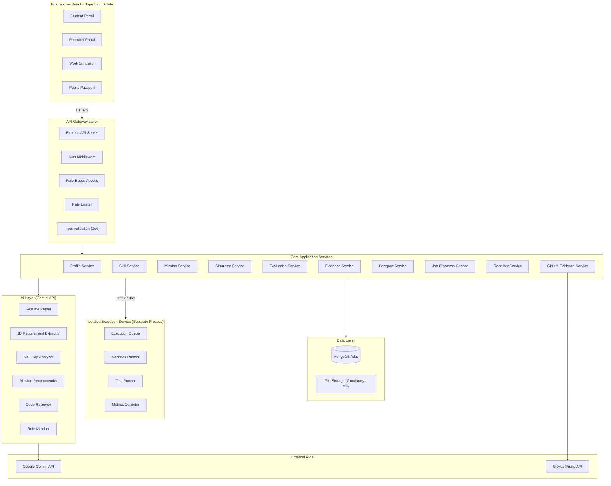

### Core Data Flow

```mermaid
flowchart LR
    A["Student Claims Skills"] --> B["GitHub Evidence (public)"]
    A --> C["Resume Parsed"]
    B --> D["Skill Inventory"]
    C --> D
    D --> E["Target Role Selected"]
    E --> F["Skill Gap Analysis"]
    F --> G["Mission Recommended"]
    G --> H["Work Simulator"]
    H --> I["Code Submitted"]
    I --> J["Isolated Execution: Tests + Metrics"]
    J --> K["AI-Assisted Code Review"]
    K --> L["Multi-Signal Evidence Generated"]
    L --> M["Passport Updated"]
    M --> N["Opportunity Matching"]
    N --> O["Recruiter Discovery"]
```

---

## B. Final Module Architecture

| Module | Domain | Description |
|---|---|---|
| **Identity & Auth** | Authentication | Registration, login, JWT tokens, role-based access |
| **Profile** | User data | Student profiles, recruiter profiles, resume upload/parse |
| **GitHub Evidence** | External evidence | Public GitHub profile/repo analysis, evidence extraction |
| **Skill Intelligence** | AI-assisted analysis | Skill extraction, JD parsing, gap analysis, mission recommendation |
| **Mission Engine** | Task management | Curated mission catalog, assignment, versioned rubrics |
| **Work Simulator** | Code environment | In-browser editor, file management, session persistence |
| **Execution Service** | Isolated execution | Sandboxed code/test running, metrics collection (separate process) |
| **Evaluation Engine** | Assessment | Orchestrates deterministic signals + AI analysis, generates evidence |
| **Evidence Vault** | Proof storage | Immutable evidence records, integrity hashing, privacy filtering |
| **Passport** | Portfolio | Capability aggregation, privacy controls, public/recruiter/private views |
| **Job Discovery** | Matching | Capability-driven role matching, gap-based recommendations |
| **Recruiter Hub** | Employer tools | Candidate search by evidence, shortlisting, evidence inspection |

### Module Dependencies

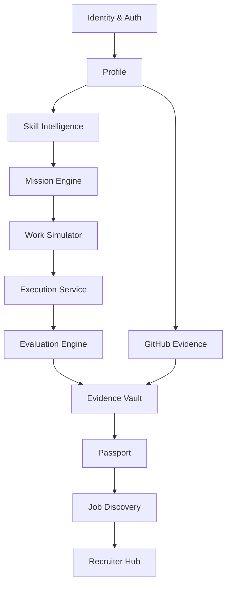

---

## C. Frontend Pages

### Page Map

```
App
├── / ................................. Landing Page
├── /login ........................... Login
├── /register ........................ Register (student or recruiter)
├── /forgot-password ................. Password Reset
│
├── /student/ ........................ Student Portal Shell
│   ├── dashboard .................... Overview: recent activity, passport summary, next steps
│   ├── profile ...................... Edit profile, resume upload, GitHub connect
│   ├── skills/ ...................... Skill Intelligence
│   │   ├── roles .................... Browse role templates / paste JD
│   │   └── gap/:roleId .............. Skill gap map for a target role
│   ├── missions/ .................... Mission Center
│   │   ├── available ................ Browse missions matched to skill gaps
│   │   ├── :id ...................... Mission detail (description, skills, difficulty)
│   │   └── history .................. Past mission attempts and results
│   ├── simulator/:attemptId ......... Work Simulator (full-screen editor)
│   ├── results/:evaluationId ........ Evaluation report with evidence
│   ├── passport ..................... Own Proof-of-Work Passport view
│   ├── opportunities ................ Matched roles and job recommendations
│   └── settings ..................... Privacy controls, account settings
│
├── /recruiter/ ...................... Recruiter Portal Shell
│   ├── dashboard .................... Overview: recent searches, shortlists
│   ├── profile ...................... Company profile
│   ├── search ....................... Search candidates by demonstrated capabilities
│   ├── candidate/:id ................ Candidate passport + evidence inspection
│   ├── shortlists ................... Manage shortlists
│   │   └── :id ...................... Shortlist detail
│   ├── jobs/ ........................ Job management
│   │   ├── new ...................... Post a job / role description
│   │   └── (list) ................... Active job postings
│   └── settings ..................... Account settings
│
├── /proof/:slug ..................... Public Passport (no auth required)
└── /404 ............................. Not found
```

### Key Page Responsibilities

| Page | What It Shows |
|---|---|
| **Landing** | Product pitch, how it works, CTAs for students and recruiters |
| **Student Dashboard** | Passport summary bar, active/recent missions, recommended next action, GitHub connection status |
| **Profile** | Edit personal info, upload resume (AI-parsed), connect public GitHub URL, declare skills |
| **Skill Gap Map** | Side-by-side: "Role requires" vs. "You have demonstrated" with evidence levels, mission recommendations per gap |
| **Mission Center** | Filter by category/difficulty/skill, mission cards with type tag, skills tested, estimated time |
| **Work Simulator** | Split layout: instructions panel (left), Monaco editor + file explorer (center), run output (bottom) |
| **Results** | Evaluation breakdown: test results, code metrics, AI feedback, evidence cards generated, improvement suggestions |
| **Passport (own)** | Categorized capabilities with evidence levels, drill into any capability to see evidence, privacy toggle |
| **Public Passport** | Read-only, privacy-filtered view of demonstrated capabilities and evidence summaries |
| **Recruiter Search** | Search by capabilities + evidence level, candidate cards ranked by evidence strength |
| **Candidate View** | Full passport view for recruiter: capabilities, evidence drill-down, mission history, contact request |

### Reusable Components

| Component | Purpose |
|---|---|
| `AppShell` | Sidebar navigation, header, responsive layout |
| `CapabilityBadge` | Skill tag with evidence level indicator (color-coded 0–4) |
| `EvidenceCard` | Single evidence record: type icon, summary, timestamp, expandable detail |
| `EvidenceLevelMeter` | Visual 5-step indicator for evidence level |
| `MissionCard` | Mission summary: title, type badge, difficulty dots, skills tested |
| `GapMapRow` | Single skill row: requirement level vs. demonstrated level with delta |
| `CandidateCard` | Recruiter search result: name, top capabilities, evidence strength |
| `CodeViewer` | Read-only code display with syntax highlighting (for evidence inspection) |
| `PrivacyToggle` | Public / Recruiter-only / Private selector |
| `EmptyState` | Consistent empty state with call-to-action |
| `LoadingSkeleton` | Shimmer loading placeholders |

---

## D. Backend Modules

### Directory Structure

```
backend/
├── src/
│   ├── server.ts                        # Entry point
│   ├── config/
│   │   ├── env.ts                       # Environment variable loading
│   │   ├── database.ts                  # MongoDB connection
│   │   └── constants.ts                 # App-wide constants
│   │
│   ├── middleware/
│   │   ├── auth.middleware.ts           # JWT verification
│   │   ├── rbac.middleware.ts           # Role-based access control
│   │   ├── rateLimiter.middleware.ts    # Rate limiting
│   │   ├── validate.middleware.ts       # Zod schema validation
│   │   └── error.middleware.ts          # Global error handler
│   │
│   ├── modules/
│   │   ├── auth/
│   │   │   ├── auth.controller.ts
│   │   │   ├── auth.service.ts
│   │   │   ├── auth.routes.ts
│   │   │   ├── auth.validation.ts       # Zod schemas
│   │   │   └── auth.types.ts
│   │   │
│   │   ├── profile/
│   │   │   ├── student.controller.ts
│   │   │   ├── student.service.ts
│   │   │   ├── recruiter.controller.ts
│   │   │   ├── recruiter.service.ts
│   │   │   ├── profile.routes.ts
│   │   │   └── profile.validation.ts
│   │   │
│   │   ├── github/
│   │   │   ├── github.controller.ts
│   │   │   ├── github.service.ts        # Public API analysis
│   │   │   ├── github.routes.ts
│   │   │   └── github.types.ts
│   │   │
│   │   ├── skill/
│   │   │   ├── skill.controller.ts
│   │   │   ├── skill.service.ts         # Gap analysis orchestration
│   │   │   ├── skill.routes.ts
│   │   │   └── skill.validation.ts
│   │   │
│   │   ├── mission/
│   │   │   ├── mission.controller.ts
│   │   │   ├── mission.service.ts       # Catalog, assignment, lifecycle
│   │   │   ├── mission.routes.ts
│   │   │   └── mission.validation.ts
│   │   │
│   │   ├── simulator/
│   │   │   ├── simulator.controller.ts
│   │   │   ├── simulator.service.ts     # Session state, file management
│   │   │   ├── simulator.routes.ts
│   │   │   └── simulator.validation.ts
│   │   │
│   │   ├── evaluation/
│   │   │   ├── evaluation.controller.ts
│   │   │   ├── evaluation.service.ts    # Orchestrate tests + AI + evidence
│   │   │   ├── evaluation.routes.ts
│   │   │   └── rubric.config.ts         # Versioned evaluation rubric
│   │   │
│   │   ├── evidence/
│   │   │   ├── evidence.controller.ts
│   │   │   ├── evidence.service.ts      # Store, validate, filter by privacy
│   │   │   └── evidence.routes.ts
│   │   │
│   │   ├── passport/
│   │   │   ├── passport.controller.ts
│   │   │   ├── passport.service.ts      # Aggregation, privacy filtering
│   │   │   ├── passport.routes.ts
│   │   │   └── passport.privacy.ts      # Privacy filtering logic
│   │   │
│   │   ├── discovery/
│   │   │   ├── discovery.controller.ts
│   │   │   ├── discovery.service.ts     # Capability-driven matching
│   │   │   └── discovery.routes.ts
│   │   │
│   │   └── recruiter/
│   │       ├── recruiter.controller.ts
│   │       ├── recruiter.service.ts     # Search, shortlists
│   │       └── recruiter.routes.ts
│   │
│   ├── ai/
│   │   ├── gemini.client.ts             # LLM API client with retry
│   │   ├── prompts/                     # Versioned prompt templates
│   │   │   ├── resume-parser.prompt.ts
│   │   │   ├── jd-extractor.prompt.ts
│   │   │   ├── gap-analyzer.prompt.ts
│   │   │   ├── code-reviewer.prompt.ts
│   │   │   └── role-matcher.prompt.ts
│   │   ├── resume-analyzer.ts
│   │   ├── jd-extractor.ts
│   │   ├── gap-analyzer.ts
│   │   ├── code-reviewer.ts
│   │   └── role-matcher.ts
│   │
│   ├── models/                          # Mongoose schemas
│   │   ├── user.model.ts
│   │   ├── studentProfile.model.ts
│   │   ├── recruiterProfile.model.ts
│   │   ├── mission.model.ts
│   │   ├── missionAttempt.model.ts
│   │   ├── submission.model.ts
│   │   ├── evaluation.model.ts
│   │   ├── evidenceRecord.model.ts
│   │   ├── passport.model.ts
│   │   ├── roleTemplate.model.ts
│   │   ├── jobListing.model.ts
│   │   ├── shortlist.model.ts
│   │   ├── githubEvidence.model.ts
│   │   └── evaluationRubric.model.ts
│   │
│   ├── shared/
│   │   ├── logger.ts
│   │   ├── errors.ts                    # Custom error classes
│   │   ├── hash.ts                      # SHA-256 for evidence integrity
│   │   └── privacy.ts                   # Privacy filtering utilities
│   │
│   └── types/
│       ├── express.d.ts                 # Express augmentation
│       └── index.ts                     # Shared type definitions
│
├── execution-service/                   # SEPARATE process/service
│   ├── src/
│   │   ├── index.ts                     # Execution service entry point
│   │   ├── queue.ts                     # Job queue manager
│   │   ├── sandbox.ts                   # Sandbox runner (child_process + resource limits)
│   │   ├── testRunner.ts                # Test execution within sandbox
│   │   ├── metrics.ts                   # Code metrics collection (lint, complexity)
│   │   └── cleanup.ts                   # Post-execution cleanup
│   ├── package.json
│   └── tsconfig.json
│
├── missions/                            # Curated mission content (version-controlled)
│   ├── backend-api-debug/
│   │   ├── manifest.json
│   │   ├── description.md
│   │   ├── starter/
│   │   ├── tests/
│   │   └── rubric.json
│   ├── rest-api-pagination/
│   └── ...
│
├── rubrics/                             # Versioned evaluation rubrics
│   ├── v1.json
│   └── rubric.schema.json
│
├── package.json
├── tsconfig.json
└── .env.example
```

### Service Responsibility Matrix

| Service | Owns | Calls | Called By |
|---|---|---|---|
| **AuthService** | Users, tokens | — | All controllers |
| **ProfileService** | Student/Recruiter profiles | AI (resume parser) | Auth, Profile routes |
| **GitHubService** | GitHub evidence | GitHub Public API, Evidence Service | Profile |
| **SkillService** | Gap analysis | AI (JD extractor, gap analyzer), Mission Service | Skill routes |
| **MissionService** | Mission catalog, attempts | AI (recommender) | Skill, Simulator |
| **SimulatorService** | Session state | Execution Service | Simulator routes |
| **ExecutionService** | Sandboxed runs | — (isolated) | Simulator, Evaluation |
| **EvaluationService** | Evaluations | Execution Service, AI (code reviewer), Evidence Service | Simulator (on submit) |
| **EvidenceService** | Evidence records | — | Evaluation, GitHub, Passport |
| **PassportService** | Passports | Evidence Service | Passport routes, Recruiter |
| **DiscoveryService** | Opportunity matching | AI (role matcher), Passport Service | Discovery routes |
| **RecruiterService** | Search, shortlists | Passport Service | Recruiter routes |

---

## E. Database Collections & Relationships

### Entity Relationship Diagram

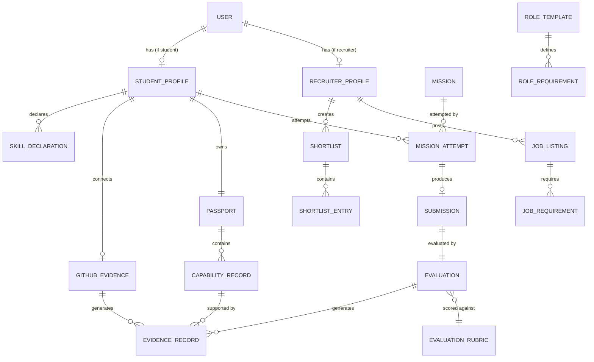

### Collection Schemas

#### `users`

```
{
  _id: ObjectId,
  email: String (unique),
  passwordHash: String,
  role: "student" | "recruiter",
  emailVerified: Boolean,
  createdAt: Date,
  updatedAt: Date,
  lastLoginAt: Date
}
```

#### `studentProfiles`

```
{
  _id: ObjectId,
  userId: ObjectId (ref: users, unique),
  name: String,
  bio: String,
  education: [{
    institution: String,
    degree: String,
    field: String,
    graduationYear: Number
  }],
  location: String,
  workPreference: "remote" | "onsite" | "hybrid",
  avatarUrl: String,

  // Resume
  resumeFileUrl: String,
  resumeParsedData: {
    extractedSkills: [{ name: String, category: String }],
    extractedExperience: [{ title: String, company: String, duration: String }],
    extractedEducation: [{ institution: String, degree: String }],
    parsedAt: Date
  },

  // GitHub (public URL, no OAuth in MVP)
  githubUsername: String,
  githubProfileUrl: String,
  githubConnected: Boolean,
  githubLastAnalyzedAt: Date,

  // Self-declared skills
  declaredSkills: [{
    name: String,
    category: String,  // "backend", "frontend", "database", "testing", etc.
    selfAssessedLevel: "beginner" | "intermediate" | "advanced"
  }],

  createdAt: Date,
  updatedAt: Date
}
```

#### `recruiterProfiles`

```
{
  _id: ObjectId,
  userId: ObjectId (ref: users, unique),
  name: String,
  position: String,
  company: {
    name: String,
    description: String,
    size: "1-10" | "11-50" | "51-200" | "201-1000" | "1000+",
    industry: String,
    website: String,
    logoUrl: String
  },
  createdAt: Date,
  updatedAt: Date
}
```

#### `missions`

```
{
  _id: ObjectId,
  slug: String (unique),
  version: Number,                  // content version for rubric compatibility

  // Mission definition (curated, version-controlled)
  title: String,
  description: String,             // markdown scenario narrative
  category: "backend" | "frontend" | "fullstack" | "api" | "debugging" | "testing" | "database",
  type: "bug_fix" | "feature_build" | "test_writing" | "refactor" | "api_design" | "debugging",
  difficulty: 1 | 2 | 3 | 4 | 5,
  timeEstimateMinutes: Number,

  // Skills this mission evaluates
  skillsTested: [{
    skillName: String,
    category: String,
    isPrimary: Boolean
  }],

  // Content (expert-designed)
  starterFiles: [{ path: String, content: String }],
  testFiles: [{ path: String, content: String }],     // hidden from student
  rubricId: ObjectId (ref: evaluationRubrics),

  // Runtime
  runtime: "node18" | "node20",
  dependencies: { [packageName]: version },            // locked dependencies

  status: "active" | "draft" | "archived",
  createdAt: Date,
  updatedAt: Date
}
```

#### `evaluationRubrics`

```
{
  _id: ObjectId,
  version: String,                  // e.g. "v1.0", "v1.1"
  name: String,
  description: String,

  // Evidence categories with configurable weights
  categories: [{
    key: String,                    // e.g. "correctness", "testing", "code_quality"
    name: String,                   // e.g. "Correctness"
    description: String,
    weight: Number,                 // 0.0–1.0, all weights sum to 1.0
    signalType: "deterministic" | "ai_assisted" | "student_authored",
    evaluationMethod: String        // how this category is measured
  }],

  // Evidence level thresholds
  levelThresholds: {
    attempted: Number,              // minimum weighted score for Level 1
    limitedEvidence: Number,        // Level 2
    demonstrated: Number,           // Level 3
    strongEvidence: Number          // Level 4
  },

  // Rules
  rules: {
    requireTestPass: Boolean,       // must pass tests for "Demonstrated"?
    requireExplanation: Boolean,    // must provide explanation for "Demonstrated"?
    maxAiWeight: Number             // cap on total AI-assisted weight (e.g. 0.30)
  },

  isActive: Boolean,
  createdAt: Date
}
```

**Default Rubric v1.0:**

| Category | Key | Weight | Signal Type |
|---|---|---|---|
| Correctness | `correctness` | 0.25 | deterministic |
| Task Completion | `task_completion` | 0.20 | deterministic |
| Test Results | `test_results` | 0.20 | deterministic |
| Code Quality | `code_quality` | 0.15 | deterministic + ai_assisted |
| Technical Explanation | `explanation` | 0.10 | student_authored + ai_assisted |
| Debugging / Approach | `approach` | 0.10 | ai_assisted |

> [!NOTE]
> Weights are configurable and versioned. The rubric can evolve without re-evaluating past submissions (each evaluation records which rubric version was used). The `maxAiWeight` rule ensures AI-only signals never exceed 30% of the total score.

#### `missionAttempts`

```
{
  _id: ObjectId,
  studentId: ObjectId (ref: studentProfiles),
  missionId: ObjectId (ref: missions),
  rubricId: ObjectId (ref: evaluationRubrics),       // locked at start time

  status: "in_progress" | "submitted" | "evaluating" | "evaluated" | "error",
  sessionFiles: [{ path: String, content: String }], // current working state
  startedAt: Date,
  lastSavedAt: Date,
  submittedAt: Date,
  timeSpentSeconds: Number
}
```

#### `submissions`

```
{
  _id: ObjectId,
  attemptId: ObjectId (ref: missionAttempts),
  studentId: ObjectId (ref: studentProfiles),
  missionId: ObjectId (ref: missions),

  files: [{ path: String, content: String }],
  technicalExplanation: String,    // student-written approach description
  submittedAt: Date
}
```

#### `evaluations`

```
{
  _id: ObjectId,
  submissionId: ObjectId (ref: submissions),
  missionId: ObjectId (ref: missions),
  studentId: ObjectId (ref: studentProfiles),
  rubricId: ObjectId (ref: evaluationRubrics),
  rubricVersion: String,

  // Deterministic signals
  testResults: {
    total: Number,
    passed: Number,
    failed: Number,
    skipped: Number,
    details: [{ testName: String, status: "pass" | "fail" | "error", message: String }]
  },
  codeMetrics: {
    lintErrors: Number,
    lintWarnings: Number,
    lintDetails: [{ rule: String, message: String, line: Number }],
    fileCount: Number,
    linesChanged: Number
  },
  taskCompletion: {
    criteriaTotal: Number,
    criteriaMet: Number,
    details: [{ criterion: String, met: Boolean }]
  },

  // AI-assisted signals (structured, bounded)
  aiAnalysis: {
    codeQuality: {
      level: "none" | "basic" | "competent" | "strong",
      observations: [String],       // specific observations, not scores
      explanation: String
    },
    approach: {
      level: "none" | "basic" | "competent" | "strong",
      observations: [String],
      explanation: String
    },
    explanationReview: {
      level: "none" | "basic" | "competent" | "strong",
      observations: [String],
      explanation: String
    },
    promptVersion: String,          // which prompt template was used
    modelVersion: String            // which LLM model was used
  },

  // Computed results
  categoryScores: [{
    key: String,
    weight: Number,
    rawScore: Number,               // 0.0–1.0
    weightedScore: Number,
    signalType: String,
    evidenceSummary: String
  }],
  overallScore: Number,             // weighted sum
  evidenceLevel: 0 | 1 | 2 | 3 | 4,
  feedback: String,                 // human-readable summary

  evaluatedAt: Date,
  evaluationDurationMs: Number
}
```

#### `evidenceRecords`

```
{
  _id: ObjectId,
  studentId: ObjectId (ref: studentProfiles),
  sourceType: "mission" | "github",

  // Mission-sourced evidence
  missionId: ObjectId (ref: missions, optional),
  submissionId: ObjectId (ref: submissions, optional),
  evaluationId: ObjectId (ref: evaluations, optional),

  // Evidence classification
  type: "TEST_RESULT" | "CODE_DIFF" | "CODE_METRICS" | "TECHNICAL_EXPLANATION" |
        "AI_CODE_REVIEW" | "TASK_COMPLETION" | "GITHUB_REPO" | "GITHUB_ACTIVITY",

  // Evidence payload (type-specific)
  data: {
    // For TEST_RESULT: { total, passed, failed, details }
    // For CODE_DIFF: { filesChanged, summary, sanitizedDiff }
    // For CODE_METRICS: { lintErrors, linesChanged }
    // For TECHNICAL_EXPLANATION: { explanationText, wordCount }
    // For AI_CODE_REVIEW: { level, observations }
    // For TASK_COMPLETION: { criteriaMet, criteriaTotal }
    // For GITHUB_REPO: { repoName, languages, description, stars, commits }
    // For GITHUB_ACTIVITY: { totalRepos, languageBreakdown, contributionSummary }
  },

  // Capability mapping
  capabilityName: String,           // e.g. "API Development"
  capabilityCategory: String,       // e.g. "backend"

  // Privacy
  visibilityLevel: "public" | "recruiter" | "private",
  sanitized: Boolean,               // sensitive data stripped?

  // Integrity
  integrityHash: String,            // SHA-256 of JSON.stringify(data)

  createdAt: Date                   // immutable — no updatedAt
}
```

> [!CAUTION]
> Evidence records are **append-only**. Once created, `data`, `integrityHash`, and `createdAt` are never modified. Only `visibilityLevel` can be updated by the student.

#### `passports`

```
{
  _id: ObjectId,
  studentId: ObjectId (ref: studentProfiles, unique),
  publicSlug: String (unique),      // e.g. "jane-doe-a1b2c3"

  capabilities: [{
    name: String,                   // e.g. "API Development"
    category: String,               // e.g. "backend"
    evidenceLevel: 0 | 1 | 2 | 3 | 4,
    evidenceCount: Number,
    evidenceIds: [ObjectId],        // refs to evidenceRecords
    lastEvidenceDate: Date,
    sources: ["mission" | "github"] // which evidence sources contributed
  }],

  // Privacy
  visibility: "public" | "recruiter" | "private",

  // Statistics (for display, not ranking)
  stats: {
    missionsCompleted: Number,
    totalEvidenceRecords: Number,
    skillsWithEvidence: Number,
    strongestCategory: String
  },

  lastUpdatedAt: Date
}
```

#### `githubEvidence`

```
{
  _id: ObjectId,
  studentId: ObjectId (ref: studentProfiles),
  githubUsername: String,
  profileUrl: String,

  // Extracted data (from public API, no OAuth)
  publicRepos: [{
    name: String,
    description: String,
    languages: { [lang]: Number },  // bytes per language
    stars: Number,
    forks: Number,
    hasReadme: Boolean,
    readmeSummary: String,          // AI-summarized, not full content
    lastPushed: Date,
    defaultBranch: String,
    commitCount: Number,            // if available via API
    topics: [String]
  }],

  languageSummary: { [lang]: Number },   // aggregate across repos
  totalPublicRepos: Number,
  accountCreated: Date,
  lastAnalyzedAt: Date,

  // What we can and cannot claim
  analysisNotes: String             // e.g. "Based on public repos only; does not verify authorship"
}
```

#### `roleTemplates`

```
{
  _id: ObjectId,
  title: String,                    // e.g. "Junior Backend Developer"
  description: String,
  category: String,                 // e.g. "backend"
  requirements: [{
    skillName: String,
    category: String,
    importance: "required" | "preferred" | "nice_to_have",
    description: String
  }],
  suggestedMissions: [ObjectId],    // refs to missions
  createdAt: Date
}
```

#### `jobListings`

```
{
  _id: ObjectId,
  recruiterId: ObjectId (ref: recruiterProfiles),
  title: String,
  company: String,
  description: String,
  requirements: [{
    skillName: String,
    category: String,
    importance: "required" | "preferred"
  }],
  location: String,
  remote: Boolean,
  experienceLevel: "entry" | "junior" | "mid",
  status: "active" | "closed",
  createdAt: Date,
  updatedAt: Date
}
```

#### `shortlists`

```
{
  _id: ObjectId,
  recruiterId: ObjectId (ref: recruiterProfiles),
  name: String,
  jobListingId: ObjectId (ref: jobListings, optional),
  entries: [{
    studentId: ObjectId (ref: studentProfiles),
    notes: String,
    addedAt: Date
  }],
  createdAt: Date,
  updatedAt: Date
}
```

### Key Indexes

| Collection | Index | Type |
|---|---|---|
| `users` | `email` | unique |
| `studentProfiles` | `userId` | unique |
| `studentProfiles` | `declaredSkills.name` | regular |
| `missions` | `category, difficulty, status` | compound |
| `missions` | `slug` | unique |
| `missionAttempts` | `studentId, missionId` | compound |
| `missionAttempts` | `status` | regular |
| `evidenceRecords` | `studentId, capabilityName` | compound |
| `evidenceRecords` | `studentId, visibilityLevel` | compound |
| `passports` | `studentId` | unique |
| `passports` | `publicSlug` | unique |
| `passports` | `capabilities.name, capabilities.evidenceLevel` | compound |
| `jobListings` | `status` | regular |
| `jobListings` | `title, description` | text |

---

## F. API Groups

### Auth — `/api/auth`

| Method | Endpoint | Auth | Description |
|---|---|---|---|
| POST | `/register` | — | Register (student or recruiter) |
| POST | `/login` | — | Login → JWT + refresh token |
| POST | `/logout` | ✓ | Invalidate refresh token |
| POST | `/refresh` | cookie | Refresh access token |
| POST | `/forgot-password` | — | Send reset email |
| POST | `/reset-password` | — | Reset with token |
| GET | `/me` | ✓ | Get current user identity |

### Student Profile — `/api/student`

| Method | Endpoint | Auth | Description |
|---|---|---|---|
| GET | `/profile` | student | Get own profile |
| PUT | `/profile` | student | Update profile |
| POST | `/profile/resume` | student | Upload resume PDF → AI parse |
| POST | `/profile/skills` | student | Add/update declared skills |
| POST | `/profile/github` | student | Submit GitHub username/URL for analysis |
| GET | `/profile/github` | student | Get GitHub analysis status/results |

### Skills & Gap Analysis — `/api/skills`

| Method | Endpoint | Auth | Description |
|---|---|---|---|
| GET | `/roles` | ✓ | List role templates |
| GET | `/roles/:id` | ✓ | Get role template detail |
| POST | `/analyze-jd` | student | AI-analyze a pasted job description |
| POST | `/gap-analysis` | student | Generate gap map (student vs. role) |

### Missions — `/api/missions`

| Method | Endpoint | Auth | Description |
|---|---|---|---|
| GET | `/` | student | List available missions (filter by category, skill, difficulty) |
| GET | `/:id` | student | Get mission description and metadata |
| POST | `/:id/start` | student | Start a mission attempt |
| GET | `/attempts` | student | List own mission attempts |
| GET | `/attempts/:id` | student | Get attempt status and details |

### Simulator — `/api/simulator`

| Method | Endpoint | Auth | Description |
|---|---|---|---|
| GET | `/session/:attemptId` | student | Load session (files, instructions, config) |
| PUT | `/session/:attemptId/save` | student | Auto-save current file state |
| POST | `/session/:attemptId/run` | student | Run code in sandbox → output |
| POST | `/session/:attemptId/test` | student | Run tests in sandbox → results |
| POST | `/session/:attemptId/submit` | student | Submit work + explanation for evaluation |

### Evaluation & Evidence — `/api/evaluation`

| Method | Endpoint | Auth | Description |
|---|---|---|---|
| GET | `/:id` | student | Get own evaluation results |
| GET | `/:id/evidence` | student | Get evidence records for an evaluation |

### Passport — `/api/passport`

| Method | Endpoint | Auth | Description |
|---|---|---|---|
| GET | `/` | student | Get own passport |
| PUT | `/privacy` | student | Set passport visibility (public/recruiter/private) |
| PUT | `/evidence/:id/privacy` | student | Set individual evidence visibility |
| GET | `/public/:slug` | — | Get public passport (privacy-filtered) |

### Discovery — `/api/discovery`

| Method | Endpoint | Auth | Description |
|---|---|---|---|
| GET | `/opportunities` | student | Get matched opportunities based on passport |
| GET | `/recommendations` | student | Get mission recommendations to improve matching |

### Recruiter — `/api/recruiter`

| Method | Endpoint | Auth | Description |
|---|---|---|---|
| GET | `/profile` | recruiter | Get own recruiter profile |
| PUT | `/profile` | recruiter | Update recruiter profile |
| GET | `/search` | recruiter | Search candidates by capabilities + evidence level |
| GET | `/candidate/:id/passport` | recruiter | View candidate passport (privacy-filtered) |
| GET | `/candidate/:id/evidence` | recruiter | Inspect candidate evidence (privacy-filtered) |
| POST | `/shortlists` | recruiter | Create shortlist |
| GET | `/shortlists` | recruiter | List own shortlists |
| POST | `/shortlists/:id/add` | recruiter | Add candidate to shortlist |
| DELETE | `/shortlists/:id/remove/:studentId` | recruiter | Remove candidate |
| POST | `/jobs` | recruiter | Post a job listing |
| GET | `/jobs` | recruiter | List own job postings |
| PUT | `/jobs/:id` | recruiter | Update job listing |

---

## G. AI Services

> [!WARNING]
> All AI services operate as **assistive analysis tools**. They provide structured analysis combined with deterministic signals. AI alone never constitutes verification.

### Service Overview

| Service | Input | Output | Role |
|---|---|---|---|
| **Resume Analyzer** | PDF resume | Structured skill/experience extraction | Assist profile building |
| **JD Extractor** | Job description text | Structured requirements list | Enable gap analysis |
| **Gap Analyzer** | Student skills + role requirements | Prioritized gap list | Guide mission selection |
| **Mission Recommender** | Skill gaps + available missions | Ranked mission suggestions | Connect gaps to tasks |
| **Code Reviewer** | Submitted code + starter code + rubric | Structured code analysis | One signal in evaluation |
| **Role Matcher** | Passport capabilities + job listings | Ranked opportunity list | Drive job discovery |

### AI Integration Architecture

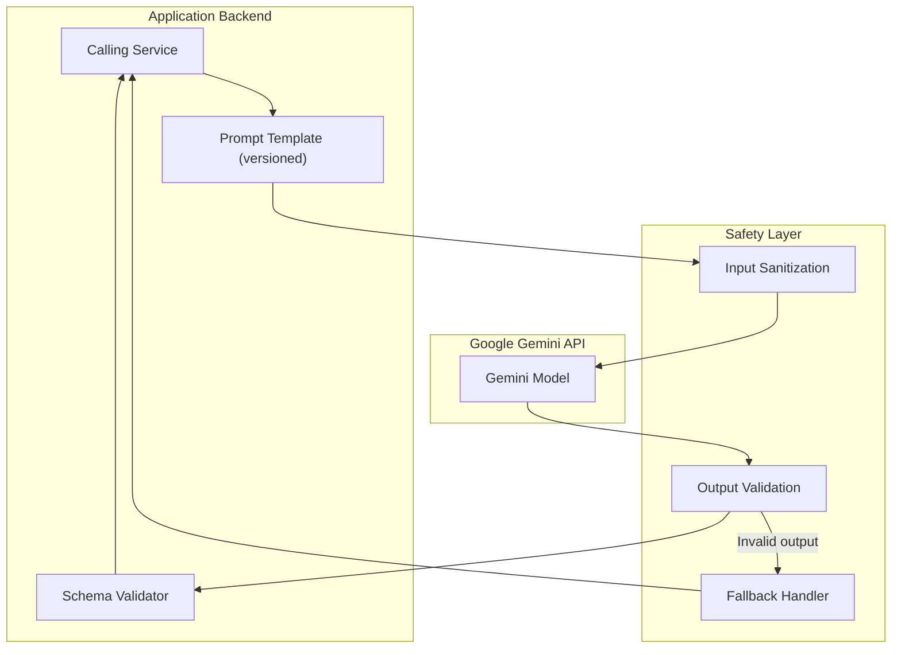

### Safety & Reliability Rules

1. **Structured output only** — all AI calls use JSON mode with predefined Zod schemas; free-text responses are rejected
2. **Bounded enums** — AI selects from fixed levels (`"none"`, `"basic"`, `"competent"`, `"strong"`), never produces numeric scores
3. **Observations, not verdicts** — AI provides specific observations ("uses nested callbacks instead of async/await"), not judgments ("bad code")
4. **Prompt versioning** — every prompt template has a version string stored alongside evaluation results
5. **Input boundaries** — student code and explanations are delimited with clear markers; system prompt instructs AI to ignore any meta-instructions within student content
6. **Output validation** — all AI responses are validated against Zod schemas; invalid responses trigger fallback
7. **Fallback** — if AI fails (timeout, invalid response, API error), evaluation proceeds with deterministic signals only; evidence level is capped at Level 2
8. **Rate limiting** — per-student and global limits on AI API calls
9. **Cost budget** — token budget per evaluation (configurable); model selection based on task type
10. **Audit trail** — prompt version, model version, raw AI response hash stored with every evaluation

---

## H. Evidence Model

### Core Philosophy

Evidence is the **atomic unit of proof**. Each record is immutable, integrity-verified, and maps a specific observable signal to a capability claim.

### Evidence Types

| Type | Source | Signal Type | Description |
|---|---|---|---|
| `TEST_RESULT` | Execution Service | Deterministic | Test suite pass/fail with per-test detail |
| `CODE_DIFF` | Submission | Deterministic | Sanitized diff: what the student changed from starter code |
| `CODE_METRICS` | Execution Service | Deterministic | Lint results, lines changed, file count |
| `TASK_COMPLETION` | Evaluation | Deterministic | Acceptance criteria met/not met |
| `TECHNICAL_EXPLANATION` | Student | Student-authored | Written approach, decisions, trade-offs |
| `AI_CODE_REVIEW` | AI Layer | AI-assisted | Structured observations on quality, approach, reasoning |
| `GITHUB_REPO` | GitHub Public API | External | Public repo: languages, description, activity |
| `GITHUB_ACTIVITY` | GitHub Public API | External | Aggregate: total repos, language distribution, activity patterns |

### Evidence Level Computation

| Level | Label | Requirements |
|---|---|---|
| **0** | No Evidence | Skill claimed but no work submitted, no GitHub evidence |
| **1** | Attempted | Mission attempted, partial submission OR minimal GitHub activity |
| **2** | Limited Evidence | Some tests pass, basic metrics, OR multiple relevant GitHub repos |
| **3** | Demonstrated | Deterministic signals pass thresholds (tests, task completion), reasonable code quality and explanation. **Cannot be reached via AI-only or GitHub-only signals.** |
| **4** | Strong Evidence | All deterministic signals strong, multiple missions completed, thorough explanations, consistent quality across submissions |

> [!IMPORTANT]
> **Level 3 ("Demonstrated") requires at minimum:**
> - Passing majority of automated tests (deterministic)
> - Meeting task completion criteria (deterministic)
> - Submitting actual code (observable)
>
> AI analysis and GitHub evidence can raise or lower within boundaries but cannot independently grant "Demonstrated" status.

### Evidence Lifecycle

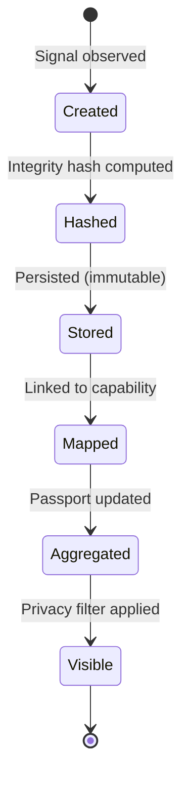

### Privacy Filtering

When evidence is displayed to someone other than the student:

| Evidence Type | Public View | Recruiter View | Private |
|---|---|---|---|
| `TEST_RESULT` | Pass/fail counts | Per-test details | Full detail |
| `CODE_DIFF` | Summary (files changed, lines) | Sanitized diff (no secrets) | Full diff |
| `CODE_METRICS` | Summary numbers | Full metrics | Full metrics |
| `TASK_COMPLETION` | Met/not met | Criteria details | Full detail |
| `TECHNICAL_EXPLANATION` | Excerpt | Full text | Full text |
| `AI_CODE_REVIEW` | Level only | Observations | Full analysis |
| `GITHUB_REPO` | Repo name, languages | +description, activity | Full detail |
| `GITHUB_ACTIVITY` | Repo count, top languages | Full summary | Full detail |

---

## I. Evaluation Model

### Evaluation Pipeline

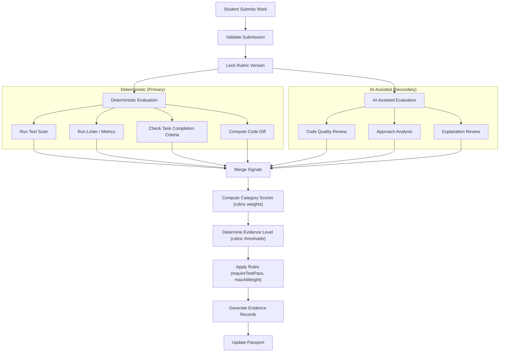

### Versioned Rubric System

```
rubrics/
├── rubric.schema.json              # JSON Schema for rubric validation
├── v1.0.json                       # Initial rubric
└── v1.1.json                       # Updated weights (future)
```

Each evaluation records:
- `rubricId` — which rubric was used
- `rubricVersion` — version string
- `categoryScores` — per-category raw and weighted scores
- `overallScore` — weighted sum
- `evidenceLevel` — final level after applying rules

**Rubrics are forward-only.** Past evaluations are never retroactively re-scored. If a rubric changes, new evaluations use the new rubric, and old evaluations retain their original rubric reference.

### Rubric Rules Engine

| Rule | Effect |
|---|---|
| `requireTestPass` | If set, "Demonstrated" (Level 3+) requires ≥70% test pass rate |
| `requireExplanation` | If set, "Demonstrated" requires a technical explanation of ≥50 words |
| `maxAiWeight` | Caps total contribution of `ai_assisted` signals (e.g., 0.30 = max 30%) |
| `minDeterministicScore` | Minimum weighted score from deterministic signals for Level 3+ |

### AI Fallback Behavior

If AI evaluation fails for any reason:

1. Evaluation proceeds with deterministic signals only
2. AI-assisted categories receive `"none"` level with explanation "AI analysis unavailable"
3. Evidence level is capped at Level 2 ("Limited Evidence")
4. A flag `aiAvailable: false` is recorded in the evaluation
5. Student is notified that AI feedback was unavailable; they may re-submit

---

## J. Secure Code Execution Architecture

> [!CAUTION]
> Student-submitted code is **untrusted input**. The execution service is the highest-risk component and must be architecturally isolated from the main application.

### Architecture Overview

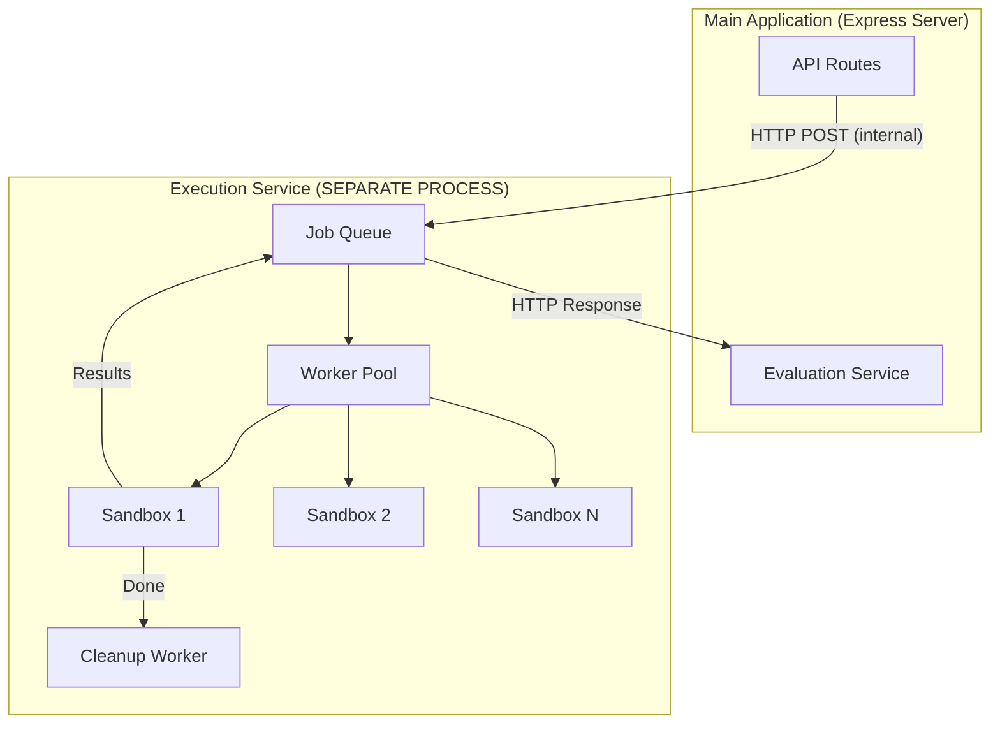

### Isolation Boundaries

The execution service runs as a **separate Node.js process** on the same machine (MVP) or a separate container (production). Communication with the main app is via HTTP on a localhost-only port, authenticated with a shared secret.

### Sandbox Constraints

| Constraint | MVP Implementation | Production Target |
|---|---|---|
| **Process Isolation** | `child_process.fork()` with `uid`/`gid` restrictions | Docker container per execution |
| **CPU** | `cpuLimit` via `ulimit` / process priority | Docker `--cpus=1` |
| **Memory** | `--max-old-space-size=128` (Node.js) + `ulimit -v` | Docker `--memory=256m` |
| **Execution Time** | Hard timeout: 30 seconds (configurable per mission) | Same |
| **Filesystem** | `tmpdir` per execution, destroyed after | Docker ephemeral volume |
| **Network** | No network: `unshare --net` (Linux) or firewall rule | Docker `--network=none` |
| **Processes** | `ulimit -u 20` | Docker `--pids-limit=50` |
| **System Calls** | N/A for MVP | seccomp profile |
| **User** | Non-root subprocess UID | Non-root container user |
| **Disk** | `tmpdir` size limited; cleaned after | Docker disk quota |

### MVP Execution Model (Realistic for 60 days)

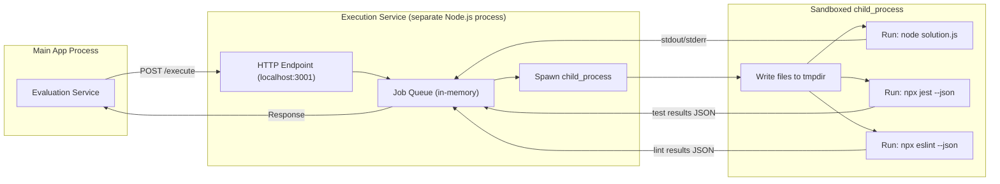

**MVP Sandbox Steps:**

1. Create a temporary directory (`mkdtemp`)
2. Write student files + hidden test files + locked `package.json` into tmpdir
3. Install dependencies from lockfile (pre-cached node_modules image)
4. Fork a child process with:
   - Working directory: tmpdir
   - Reduced memory limit (`--max-old-space-size=128`)
   - Hard timeout (kill after 30 seconds)
   - Non-root UID if on Linux
5. Run test suite (`jest --json`) → capture JSON results
6. Run linter (`eslint --format json`) → capture JSON results
7. Optionally run student code → capture stdout/stderr (truncated at 50KB)
8. Kill child process if still running after timeout
9. Read results
10. **Delete tmpdir** (always, even on error)

### What We Do NOT Do

- ❌ No `eval()` or `vm` module for running student code (insufficient isolation)
- ❌ No network access from sandbox
- ❌ No access to main application database or config
- ❌ No student-controlled `package.json` or `npm install`
- ❌ No persistent storage across executions
- ❌ No student access to test files (tests are hidden)

### Execution Security Checklist

- [ ] Execution service listens only on `localhost`
- [ ] Shared secret required for all requests
- [ ] Tmpdir created with restricted permissions
- [ ] Child process killed on timeout (SIGKILL after SIGTERM)
- [ ] Tmpdir cleaned up in `finally` block
- [ ] stdout/stderr output truncated
- [ ] File count and size limits enforced before writing
- [ ] Dependencies pre-installed, not student-controlled
- [ ] No `.env`, config, or secrets accessible in sandbox
- [ ] Execution results validated before returning

---

## K. GitHub Evidence Architecture

### MVP Scope (Public API, No OAuth)

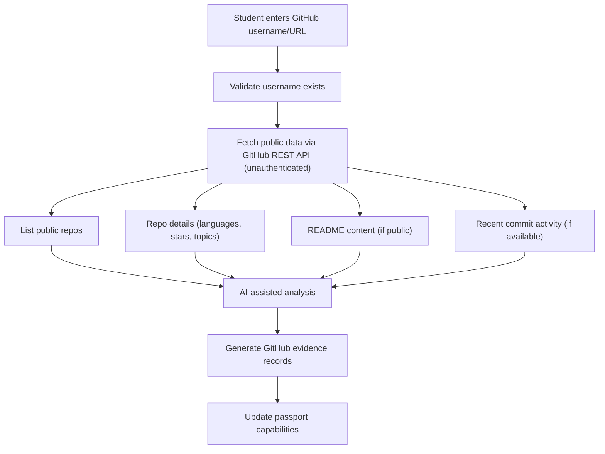

### What We Extract (Public API)

| Data Point | API Endpoint | Evidence Use |
|---|---|---|
| Public repo list | `GET /users/:username/repos` | Repo count, diversity, recency |
| Repo languages | `GET /repos/:owner/:repo/languages` | Language evidence |
| Repo metadata | `GET /repos/:owner/:repo` | Stars, forks, description, topics, last push date |
| README content | `GET /repos/:owner/:repo/readme` | Project context (AI-summarized) |
| Commit activity | `GET /repos/:owner/:repo/stats/participation` | Activity patterns |

### What We Do NOT Claim

> [!WARNING]
> GitHub evidence provides **supporting context**, not proof of skill:
> - Having a repo with Node.js code does not prove the student wrote it
> - Stars/forks do not prove code quality
> - Commit history does not prove authorship (could be copied)
> - Absence of GitHub activity does not mean absence of skill

GitHub evidence:
- **Can** contribute to evidence (e.g., "Student has 5 public repos using Express.js")
- **Cannot** alone elevate a capability to "Demonstrated" (Level 3)
- **Is labeled** as `sourceType: "github"` in evidence records so it is always distinguishable

### Rate Limiting

- GitHub unauthenticated API: 60 requests/hour per IP
- Analysis is batched: one full analysis per student per 24 hours max
- Results are cached in `githubEvidence` collection
- Student can manually trigger re-analysis (rate limited)

### Phase 2: Full GitHub Integration

In Phase 2, with OAuth:
- Access private repos (with student consent)
- Richer commit analysis (diffs, authored vs. merged)
- Contribution to other projects (PRs, issues)
- GitHub Actions / CI evidence
- More reliable authorship signals

---

## L. Privacy Model

### Privacy Levels

| Level | Who Can See | Passport View | Evidence View |
|---|---|---|---|
| **Public** | Anyone with the URL | Full capability summary | Summary evidence (test counts, metrics, level) |
| **Recruiter** | Authenticated recruiters | Full capabilities + details | Detailed evidence (sanitized code, test details, explanations) |
| **Private** | Student only | Full detail | Full detail including raw code |

### Privacy Controls

**Passport-level privacy:**
- Student sets default visibility for their entire passport: Public / Recruiter / Private
- This controls who can discover and view the passport

**Evidence-level privacy (granular):**
- Student can override visibility for individual evidence records
- Example: passport is "Recruiter" but one specific code submission is "Private"
- Default evidence visibility inherits from passport setting

### What Is Never Exposed

Regardless of privacy level, the following are **never** shown to external viewers:

| Data | Reason |
|---|---|
| Student's raw source code (unless explicitly set to recruiter/public) | IP protection |
| Environment variables, API keys, secrets | Security |
| Hidden test suite source code | Mission integrity |
| Mission reference solutions | Mission integrity |
| Student's email address | Privacy (contact via platform request) |
| AI raw prompts and responses | System integrity |
| Evaluation rubric weights and thresholds | System integrity |
| Other students' data | Privacy |

### Sanitization Pipeline

Before evidence is displayed to anyone other than the student:

1. **Code diffs** — strip comments containing secrets, redact environment variables, show summary statistics instead of full diff (unless recruiter-visible)
2. **Technical explanations** — shown as-is (student-authored, they control content)
3. **Test results** — show pass/fail counts; detailed test names only at recruiter level
4. **AI analysis** — show level and observations; full analysis only at recruiter level
5. **GitHub data** — public data shown as-is (it's already public on GitHub)

### Recruiter Contact Flow

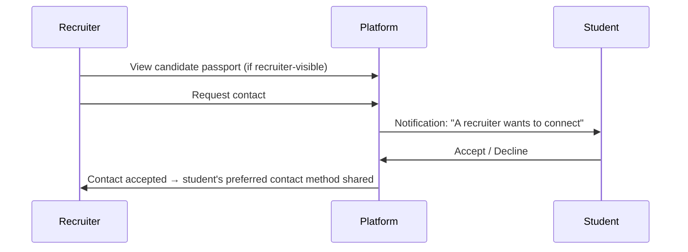

Students are never contacted without their consent.

---

## M. Student Journey

### Complete Journey Map

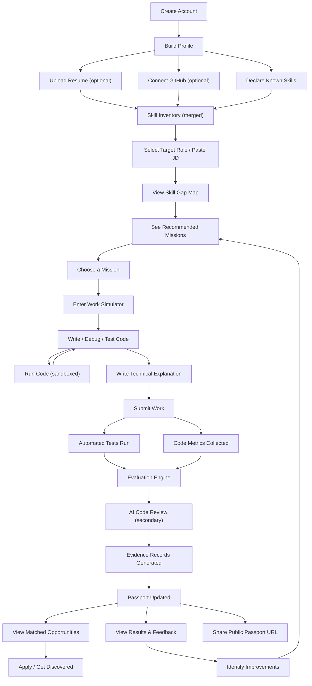

### Journey at Each Stage

| Stage | Student Does | Platform Provides |
|---|---|---|
| **Profile** | Enters info, uploads resume, connects GitHub | AI-parsed skills, GitHub analysis |
| **Role Selection** | Picks target role or pastes JD | Curated role templates, AI JD analysis |
| **Gap Analysis** | Reviews gaps, prioritizes | Visual gap map, mission recommendations |
| **Mission** | Reads scenario, understands codebase | Realistic workplace scenario, starter code |
| **Simulator** | Writes code, runs tests, debugs | Editor, terminal, live output, instructions |
| **Submission** | Writes explanation, submits | Submission confirmation, queue status |
| **Evaluation** | Waits, then reviews results | Test results, metrics, AI feedback, evidence |
| **Passport** | Reviews capabilities, adjusts privacy | Aggregated capability view, privacy controls |
| **Discovery** | Browses matched opportunities | Capability-matched roles, gap recommendations |

---

## N. Recruiter Journey

### Complete Journey Map

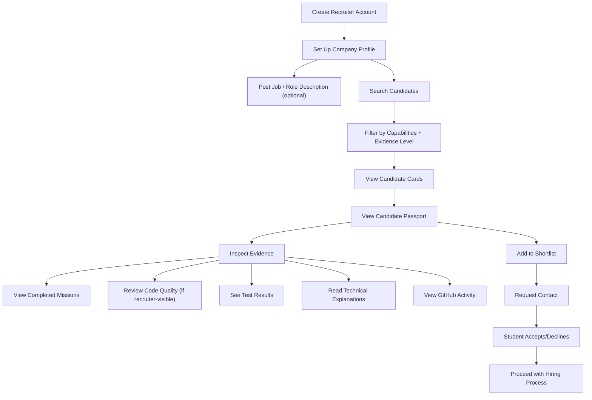

### Recruiter Value Proposition

| Traditional Hiring | With WorkProof AI |
|---|---|
| Resume says "Node.js" | Passport shows "API Development — Demonstrated" with 3 evidence records |
| "3 years experience" | Completed 5 missions, 89% test pass rate, strong code quality |
| Self-reported skills | Observable evidence: tests passed, code submitted, explanations written |
| Phone screen to assess | Evidence already inspectable before first contact |
| Keyword matching | Capability-based search with evidence level filters |

### What Recruiters See (Privacy-Filtered)

```
┌──────────────────────────────────────────────────────────────┐
│  Jane Doe — Junior Backend Developer                          │
│  📍 Remote  •  🎓 CS, State University, 2025                  │
│                                                                │
│  Demonstrated Capabilities:                                    │
│  ████████░░ API Development          — Demonstrated (L3)       │
│  ████████░░ Debugging                — Demonstrated (L3)       │
│  ██████░░░░ Testing                  — Limited Evidence (L2)   │
│  ████░░░░░░ Database                 — Attempted (L1)          │
│                                                                │
│  Evidence Sources: 4 missions, 12 evidence records, GitHub     │
│                                                                │
│  [View Full Passport]  [Add to Shortlist]  [Request Contact]  │
└──────────────────────────────────────────────────────────────┘
```

---

## O. MVP Scope (Must Have for Hackathon)

### The One Loop That Must Work

```
Job/JD → Skill Analysis → Skill Gap → Work Mission → Student Submission
→ Evaluation → Evidence → Proof-of-Work Passport → Recruiter View
```

Every feature below directly enables this loop.

### MUST HAVE — Hackathon MVP

| # | Feature | Module |
|---|---|---|
| 1 | Student registration and login (email/password) | Auth |
| 2 | Recruiter registration and login (email/password) | Auth |
| 3 | Student profile: name, bio, education, declared skills | Profile |
| 4 | Resume upload (PDF) with AI skill extraction | Profile + AI |
| 5 | GitHub public profile analysis (username → evidence) | GitHub |
| 6 | Recruiter company profile | Profile |
| 7 | Curated role templates (minimum 5) | Mission Engine |
| 8 | Skill gap analysis (student skills vs. role requirements) | Skill Intelligence |
| 9 | Mission catalog (minimum 5 curated missions) | Mission Engine |
| 10 | Mission recommendation based on skill gaps | Skill Intelligence + AI |
| 11 | Work Simulator: Monaco editor, file explorer, instructions panel | Simulator |
| 12 | Run code in isolated sandbox (tests + metrics) | Execution Service |
| 13 | Submit work with technical explanation | Simulator |
| 14 | Multi-signal evaluation (tests + metrics + AI review) | Evaluation Engine |
| 15 | Versioned evaluation rubric (v1.0) | Evaluation Engine |
| 16 | Evidence record generation (immutable, hashed) | Evidence Vault |
| 17 | Proof-of-Work Passport with capability aggregation | Passport |
| 18 | Passport privacy controls (Public / Recruiter / Private) | Passport |
| 19 | Public shareable passport URL | Passport |
| 20 | Recruiter candidate search by demonstrated capabilities | Recruiter Hub |
| 21 | Recruiter candidate passport view (privacy-filtered) | Recruiter Hub |
| 22 | Recruiter evidence inspection (privacy-filtered) | Recruiter Hub |
| 23 | Recruiter shortlisting (create list, add candidates) | Recruiter Hub |
| 24 | Opportunity matching (passport capabilities → roles) | Discovery |
| 25 | Landing page | Frontend |
| 26 | Responsive design (desktop + tablet) | Frontend |
| 27 | Input validation on all endpoints (Zod) | Backend |
| 28 | Rate limiting on auth endpoints | Backend |
| 29 | Deployment (frontend + backend + DB) | DevOps |

### SHOULD HAVE (if time permits within 60 days)

| # | Feature | Reason |
|---|---|---|
| 1 | Recruiter job posting | Enables direct matching, not just search |
| 2 | AI-analyzed job description (paste JD → requirements) | Richer than template-only roles |
| 3 | Student dashboard with next-step recommendations | Better UX |
| 4 | Email notifications (evaluation complete, recruiter interest) | Engagement |
| 5 | Results page with improvement suggestions | Feedback loop |
| 6 | Mobile-responsive design | Broader access |
| 7 | Recruiter contact request flow | Complete hiring signal |

### OUT OF SCOPE — Phase 2 / Future

| Feature | Reason for Deferral |
|---|---|
| GitHub OAuth + private repo access | Adds OAuth complexity; public API sufficient for MVP |
| AI-generated missions | Quality control risk; curated missions are safer |
| Docker-based execution | Infrastructure complexity; child_process sufficient for MVP |
| Real-time WebSocket terminal | Engineering effort; run-and-return sufficient |
| PDF passport export | Nice to have, not core loop |
| Candidate comparison view | Recruiter convenience, not core |
| Admin panel | Internal tooling, not demo-critical |
| Multi-language support (Python, Java) | Scope expansion; Node.js focus for MVP |
| Team/collaborative missions | Major feature, post-MVP |
| Apprenticeship mode (org-provided tasks) | Requires org onboarding, post-MVP |
| Payment/subscription | No monetization in hackathon |

---

## P. Phase 2 Scope

### Phase 2 Features (Post-Hackathon)

| Category | Feature | Description |
|---|---|---|
| **GitHub** | Full OAuth integration | Private repos, richer commit analysis, PR/issue activity |
| **GitHub** | Authorship confidence | Analyze commit patterns for authorship signals |
| **Missions** | AI-assisted mission generation | Generate missions from skill gaps (with human review) |
| **Missions** | Multi-language support | Python, Java, Go mission runtimes |
| **Execution** | Docker-based isolation | Full container isolation with seccomp, network=none |
| **Execution** | Real-time terminal | WebSocket terminal in Work Simulator |
| **Evaluation** | Rubric v2.0 | Refined weights based on MVP data |
| **Evaluation** | Re-evaluation capability | Re-run evaluation with updated rubric |
| **Recruiter** | Job posting + auto-matching | Post JD, auto-match to candidates |
| **Recruiter** | Candidate comparison | Side-by-side capability comparison |
| **Recruiter** | Contact request flow | Full in-platform communication |
| **Passport** | PDF export | Downloadable passport summary |
| **Passport** | Embeddable badge | Embed passport summary on personal website |
| **Discovery** | Job board integration | Pull listings from LinkedIn, Indeed APIs |
| **Platform** | Admin panel | Mission management, user management, analytics |
| **Platform** | Email notifications | Transactional email for key events |
| **Platform** | Analytics dashboard | Platform health metrics |
| **Scale** | Microservices migration | Decompose monolith as load requires |
| **Scale** | CDN and caching | Redis caching, CDN for static assets |

---

## Q. Exact 60-Day Development Roadmap

### Overview

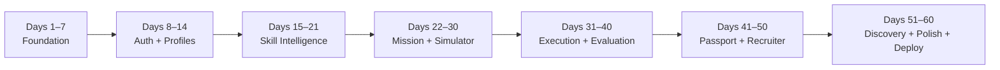

---

### Days 1–7: Foundation

**Goal:** Project scaffolding, database, deployment pipeline, basic UI shell.

| Day | Backend | Frontend |
|---|---|---|
| 1 | Project init: Express + TypeScript, folder structure, ESLint, Prettier | Project init: Vite + React + TypeScript, Tailwind CSS, shadcn/ui |
| 2 | MongoDB Atlas setup, Mongoose connection, env config | React Router setup, layout shell (sidebar, header), route structure |
| 3 | Mongoose models: `users`, `studentProfiles`, `recruiterProfiles` | Landing page design and implementation |
| 4 | Error handling middleware, logger (Winston), base controller patterns | Reusable components: Button, Input, Card, Badge, EmptyState, LoadingSkeleton |
| 5 | Zod validation middleware, request validation patterns | Axios client setup, API interceptors, auth context scaffolding |
| 6 | Rate limiting middleware, Helmet security headers, CORS config | Login page, Register page (student/recruiter toggle) |
| 7 | First deploy: backend to Railway/Render, frontend to Vercel, CI/CD setup | Connect frontend to backend, verify deployment works end-to-end |

**Milestone:** Deployed skeleton with landing page, routing, database connected.

---

### Days 8–14: Authentication + Profiles

**Goal:** Working auth system, student and recruiter profiles.

| Day | Backend | Frontend |
|---|---|---|
| 8 | Auth service: register (bcrypt hash), login (JWT + refresh token) | Auth flow: login form, register form, token storage, redirect |
| 9 | Auth middleware: JWT verification, refresh token rotation | Auth context: protected routes, role-based redirects |
| 10 | Student profile CRUD: create, read, update | Student profile page: view and edit form |
| 11 | Recruiter profile CRUD: create, read, update | Recruiter profile page: company info form |
| 12 | Resume upload: Multer file handling, Cloudinary/S3 storage | Resume upload UI: drag-and-drop, upload progress |
| 13 | AI resume parser: Gemini API integration, skill extraction from PDF text | Profile page: show parsed skills, edit/confirm extracted skills |
| 14 | Skill declaration API: add/update/remove declared skills | Skill declaration UI: add skills with category and self-assessment |

**Milestone:** Users can register, login, create profiles, upload resume (AI-parsed), declare skills.

---

### Days 15–21: Skill Intelligence + GitHub Evidence

**Goal:** Role templates, skill gap analysis, GitHub public analysis.

| Day | Backend | Frontend |
|---|---|---|
| 15 | Role template model + seed data (5 role templates with requirements) | Skill section: browse role templates page |
| 16 | JD extractor AI service: analyze pasted JD → structured requirements | Role detail view with requirements list |
| 17 | Gap analysis service: compare student skills/evidence vs. role requirements | Skill gap map page: side-by-side comparison visualization |
| 18 | Mission recommendation logic: map skill gaps to available missions | Gap map: mission recommendations per gap |
| 19 | GitHub evidence service: fetch public repos, languages, metadata | Profile: GitHub username input, connect button, loading state |
| 20 | GitHub evidence processing: AI-summarize README, generate evidence records | Profile: GitHub analysis results display (repos, languages, activity) |
| 21 | Integration testing: profile → skills → gap analysis → GitHub evidence | End-to-end: student flow from profile to gap analysis with GitHub data |

**Milestone:** Students see skill gaps against target roles, GitHub activity analyzed, missions recommended.

---

### Days 22–30: Mission Engine + Work Simulator

**Goal:** Curated mission catalog, in-browser code editor, session management.

| Day | Backend | Frontend |
|---|---|---|
| 22 | Mission model, seed first 2 curated missions (bug_fix, feature_build) | Mission Center page: mission list with filters (category, difficulty) |
| 23 | Seed 3 more curated missions (test_writing, debugging, api_design) | Mission card component, mission detail page |
| 24 | Mission attempt lifecycle: start, save, submit | Start mission flow: create attempt, redirect to simulator |
| 25 | Simulator session service: load files, save files (auto-save) | Work Simulator layout: split panes (instructions, editor, output) |
| 26 | — | Monaco editor integration: multi-file tabs, syntax highlighting |
| 27 | — | File explorer component: tree view, file selection |
| 28 | — | Instructions panel: mission description, evaluation criteria, hints |
| 29 | Session persistence: auto-save every 30s, resume capability | Auto-save indicator, resume mission from history |
| 30 | Submission endpoint: validate, store files + technical explanation | Submit dialog: technical explanation textarea, confirm submission |

**Milestone:** Students can browse missions, open Work Simulator, write code in Monaco, save sessions, submit work.

---

### Days 31–40: Execution Service + Evaluation Engine

**Goal:** Sandboxed code execution, automated evaluation, evidence generation.

| Day | Backend | Frontend |
|---|---|---|
| 31 | Execution service: separate process, HTTP endpoint, shared secret auth | — |
| 32 | Sandbox runner: child_process fork, tmpdir, resource limits, timeout | — |
| 33 | Test runner: execute Jest in sandbox, capture JSON results | — |
| 34 | Metrics collector: run ESLint in sandbox, compute code diff | — |
| 35 | Integrate execution service: "Run Code" endpoint → sandbox → output | Simulator: "Run Code" button, output panel with stdout/stderr |
| 36 | Integrate test runner: "Run Tests" endpoint → sandbox → results | Simulator: "Run Tests" button, test results display |
| 37 | Evaluation rubric: v1.0 JSON definition, rubric loader, schema validation | — |
| 38 | Evaluation engine: orchestrate tests + metrics + AI code review | — |
| 39 | AI code reviewer: Gemini structured analysis, output validation, fallback | — |
| 40 | Evidence generation: create immutable records, compute integrity hash, link to capabilities | Results page: evaluation report, test results, metrics, AI feedback, evidence cards |

**Milestone:** Code runs in sandbox, tests execute, AI reviews code, evidence records created.

---

### Days 41–50: Passport + Recruiter Portal

**Goal:** Proof-of-Work Passport, privacy controls, recruiter search and inspection.

| Day | Backend | Frontend |
|---|---|---|
| 41 | Passport service: aggregate evidence → capability records, compute evidence levels | — |
| 42 | Passport privacy: filtering logic for public/recruiter/private views | Passport page: capability dashboard with evidence level meters |
| 43 | Evidence privacy: per-record visibility control, sanitization pipeline | Passport: drill-down evidence inspector per capability |
| 44 | Public passport API: slug-based, privacy-filtered response | Public passport page (/proof/:slug): shareable, no auth required |
| 45 | Student privacy settings page: passport visibility toggle, per-evidence controls | Settings page: privacy controls UI |
| 46 | Recruiter search API: filter by capabilities, evidence levels, skills | Recruiter search page: capability filters, evidence level selectors |
| 47 | Recruiter search results: candidate cards ranked by evidence strength | Candidate cards: name, top capabilities, evidence summary |
| 48 | Recruiter candidate view: full passport (privacy-filtered) | Candidate detail page: passport view + evidence inspector |
| 49 | Shortlist CRUD: create list, add/remove candidates | Shortlist management: create, view, add/remove candidates |
| 50 | Mission history: student's past attempts, results, evidence links | Mission history page: past missions with status and evidence links |

**Milestone:** Passport with privacy controls, public sharing, recruiter search and shortlisting working.

---

### Days 51–60: Discovery + Integration + Polish + Demo

**Goal:** Opportunity matching, end-to-end testing, UX polish, deployment, demo readiness.

| Day | Task |
|---|---|
| 51 | **Discovery service:** capability-driven opportunity matching (passport → roles/jobs) |
| 52 | **Opportunities page:** matched roles with match strength, gap indicators, recommended missions |
| 53 | **End-to-end testing:** complete student journey (register → profile → gap → mission → submit → evidence → passport) |
| 54 | **End-to-end testing:** complete recruiter journey (register → search → inspect → shortlist) |
| 55 | **Bug fixes:** fix all critical bugs found during E2E testing |
| 56 | **UX polish:** loading states, empty states, error messages, form validation feedback, responsive layout |
| 57 | **Landing page polish:** clear product narrative, feature highlights, CTA flows, professional design |
| 58 | **Demo data:** seed a complete demo student (profile, GitHub, missions completed, passport with evidence) |
| 59 | **Final deployment:** production build, environment variables, health checks, monitoring |
| 60 | **Demo preparation:** walkthrough script, screenshots, presentation materials, final smoke test |

**Milestone:** Polished, deployed, demo-ready MVP with complete working loop.

---

### Risk Mitigation — If Behind Schedule

Priority order (cut from bottom first):

| Priority | Feature | Fallback |
|---|---|---|
| 🟢 **Never cut** | Work Simulator → Evaluation → Evidence → Passport | This IS the product |
| 🟢 **Never cut** | Recruiter passport view + search | This completes the loop |
| 🟡 **Simplify** | Gap analysis visualization | Text list instead of chart |
| 🟡 **Simplify** | Recruiter shortlisting | View-only, no lists |
| 🟡 **Reduce** | Number of curated missions | Ship with 3 instead of 5 |
| 🟠 **Defer** | GitHub evidence analysis | Manual skill entry only |
| 🟠 **Defer** | Opportunity matching | Static role list |
| 🔴 **Last resort** | AI resume parsing | Manual profile only |

---

## Track Alignment Matrix

Every major feature mapped to its track contribution:

| Feature | Job Discovery | Portfolio Building | Apprenticeships / Work-based Learning | Hiring Signal | First-time Coders / Youth |
|---|---|---|---|---|---|
| **Skill Gap Analysis** | ✅ Identifies roles that match skills | ✅ Shows which capabilities need evidence | — | ✅ Clarifies what employers need | ✅ Guides what to learn next |
| **Work Missions** | — | ✅ Creates portfolio artifacts | ✅ Simulates real engineering work | ✅ Tests real-world capability | ✅ First experience with workplace-style tasks |
| **Work Simulator** | — | — | ✅ IDE-like environment mirrors real job | — | ✅ Safe space to practice real coding |
| **Evaluation Engine** | — | — | ✅ Feedback mirrors code review | ✅ Observable, multi-signal assessment | ✅ Actionable feedback for growth |
| **Evidence Records** | — | ✅ Concrete proof artifacts | — | ✅ Verifiable hiring signal | ✅ First professional evidence |
| **Proof-of-Work Passport** | ✅ Capabilities match to opportunities | ✅ Evidence-backed portfolio | ✅ Record of work-based learning | ✅ Inspectable by recruiters | ✅ Professional credential for first job |
| **GitHub Evidence** | — | ✅ Existing work incorporated | — | ✅ Additional evidence signal | ✅ Leverages existing student projects |
| **Opportunity Matching** | ✅ Capability-driven discovery | — | — | ✅ Match quality from evidence | ✅ Find suitable entry-level roles |
| **Recruiter Search** | ✅ Discover verified candidates | — | — | ✅ Search by demonstrated skill | ✅ Surface overlooked first-time candidates |
| **Recruiter Evidence View** | — | — | — | ✅ Inspect actual work quality | ✅ Replace credential bias with evidence |
| **Resume Parsing** | ✅ Extract skills for matching | ✅ Auto-populate profile | — | — | ✅ Lower barrier to profile creation |
| **Privacy Controls** | — | ✅ Student controls their portfolio | — | — | ✅ Safe, consent-based sharing |

---

## Summary

This architecture delivers one fundamental promise:

**A student claims a skill → completes a realistic work mission → the platform evaluates with observable, multi-signal evidence → the evidence builds a Proof-of-Work Passport → a recruiter can discover, inspect, and trust that evidence.**

Key architectural commitments:
- **Evidence over AI scores** — deterministic signals are primary; AI assists, never verifies alone
- **Curated missions** — expert-designed, version-controlled task definitions
- **Isolated execution** — separate service, strict sandboxing, no shortcuts
- **Versioned rubrics** — configurable, evolvable, auditable evaluation criteria
- **Student-controlled privacy** — Public / Recruiter / Private at passport and evidence level
- **GitHub in MVP** — public API analysis as supporting evidence, not sole proof
- **Complete loop in 60 days** — every day mapped, every feature prioritized, fallbacks defined

Ready for implementation upon approval.
