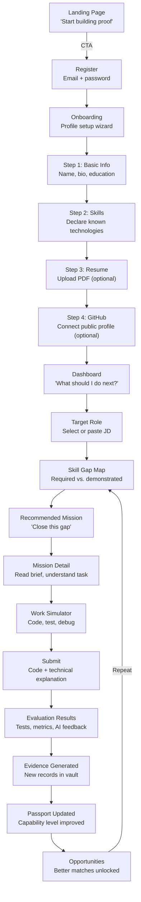
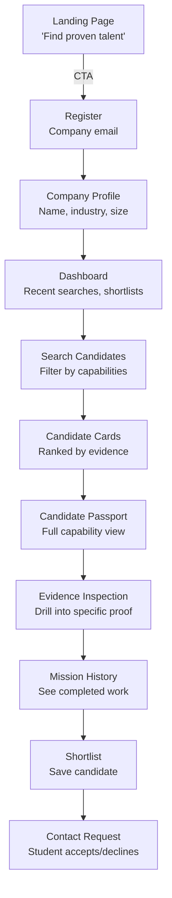

# WorkProof AI — UI/UX Architecture & Design System

> **"From Skills to Proof to Opportunity."**

---

## Table of Contents

- [A. Final Design System](#a-final-design-system)
- [B. Navigation Architecture](#b-navigation-architecture)
- [C. Complete Page List](#c-complete-page-list)
- [D. Student Journey](#d-student-journey)
- [E. Recruiter Journey](#e-recruiter-journey)
- [F. Public Passport Journey](#f-public-passport-journey)
- [G. Component Inventory](#g-component-inventory)
- [H. Page Wireframe Specifications](#h-page-wireframe-specifications)
- [I. Responsive Strategy](#i-responsive-strategy)
- [J. Hackathon Demo Flow](#j-hackathon-demo-flow)

---

## A. Final Design System

### A1. Design Philosophy

WorkProof AI's visual language communicates four things instantly:

1. **Trustworthiness** — this is a serious professional tool, not a toy
2. **Clarity** — evidence is understandable at a glance
3. **Action-orientation** — the next step is always obvious
4. **Evidence over score** — observable proof is always the primary signal

Every screen answers: *"What has been demonstrated, and what should happen next?"*

> [!IMPORTANT]
> ### Core UI Principle: Evidence > Score
>
> Throughout the entire product, **observable evidence is the primary hiring signal**, not numerical scores, not AI-generated ratings, not abstract indicators.
>
> **Every capability display must follow this hierarchy:**
>
> 1. **Capability name** — what skill area
> 2. **Evidence level label** — textual status (Demonstrated, Limited Evidence, etc.)
> 3. **Evidence summary** — what was done (mission name, test results, code submitted)
> 4. **Task/mission context** — which work produced this evidence
> 5. **Test/outcome details** — inspectable results (pass/fail counts, metrics)
> 6. **Date/context** — when, what version, what rubric
>
> **Never present:**
> - A numerical score as the primary indicator of capability
> - An evidence level without accompanying evidence summary
> - An AI assessment without the deterministic signals that support it
> - Dots, bars, or visual indicators as a replacement for inspectable evidence

---

### A2. Typography

**Font Family:** `Inter` (primary), `JetBrains Mono` (code/monospace)

Inter is chosen for its exceptional legibility at all sizes, professional tone, and open-source availability. JetBrains Mono is used exclusively for code, terminal output, and technical evidence data.

| Token | Size | Weight | Line Height | Letter Spacing | Usage |
|---|---|---|---|---|---|
| `display` | 36px / 2.25rem | 700 (Bold) | 1.2 | -0.02em | Landing hero headline |
| `h1` | 30px / 1.875rem | 700 (Bold) | 1.25 | -0.015em | Page titles |
| `h2` | 24px / 1.5rem | 600 (Semibold) | 1.3 | -0.01em | Section headings |
| `h3` | 20px / 1.25rem | 600 (Semibold) | 1.35 | -0.005em | Card titles, subsections |
| `h4` | 16px / 1rem | 600 (Semibold) | 1.4 | 0 | Labels, small headings |
| `body-lg` | 18px / 1.125rem | 400 (Regular) | 1.6 | 0 | Lead paragraphs, landing copy |
| `body` | 14px / 0.875rem | 400 (Regular) | 1.6 | 0 | Default body text |
| `body-sm` | 13px / 0.8125rem | 400 (Regular) | 1.5 | 0 | Secondary text, descriptions |
| `caption` | 12px / 0.75rem | 500 (Medium) | 1.4 | 0.01em | Timestamps, metadata, labels |
| `overline` | 11px / 0.6875rem | 600 (Semibold) | 1.4 | 0.08em | Category labels (uppercase) |
| `code` | 13px / 0.8125rem | 400 (Regular) | 1.5 | 0 | Code, terminal, technical data (JetBrains Mono) |

**Rules:**
- Maximum 2 font weights per visual group
- Never use font weight below 400 for body text
- Code always uses `JetBrains Mono`
- No decorative fonts anywhere in the product

---

### A3. Color System

#### Brand Colors

| Token | Hex | Usage |
|---|---|---|
| `primary-900` | `#1a2332` | Primary text on light, deepest primary |
| `primary-800` | `#1e3a5f` | Dark accents, active nav |
| `primary-700` | `#1e4d8c` | Primary buttons, key actions |
| `primary-600` | `#2563eb` | Primary interactive (links, buttons, focus) |
| `primary-500` | `#3b82f6` | Hover states, lighter primary accent |
| `primary-100` | `#dbeafe` | Light primary backgrounds, selected states |
| `primary-50` | `#eff6ff` | Subtle primary backgrounds |

**Primary is a confident deep blue** — professional, trustworthy, employer-ready. Not playful, not startup-casual.

#### Neutral Palette

| Token | Hex | Usage |
|---|---|---|
| `neutral-950` | `#0a0a0b` | Highest contrast text |
| `neutral-900` | `#18181b` | Primary text |
| `neutral-700` | `#3f3f46` | Secondary text |
| `neutral-500` | `#71717a` | Tertiary text, placeholders |
| `neutral-400` | `#a1a1aa` | Disabled text |
| `neutral-300` | `#d4d4d8` | Borders |
| `neutral-200` | `#e4e4e7` | Dividers, subtle borders |
| `neutral-100` | `#f4f4f5` | Backgrounds (sections, cards) |
| `neutral-50` | `#fafafa` | Page background |
| `white` | `#ffffff` | Card backgrounds, inputs |

#### Semantic Colors

| Token | Hex | Text on White | Usage |
|---|---|---|---|
| `success-700` | `#15803d` | ✅ AA | Test passed, demonstrated, positive |
| `success-100` | `#dcfce7` | — | Success background |
| `warning-700` | `#a16207` | ✅ AA | Limited evidence, attention needed |
| `warning-100` | `#fef9c3` | — | Warning background |
| `error-700` | `#b91c1c` | ✅ AA | Test failed, error, critical gap |
| `error-100` | `#fee2e2` | — | Error background |
| `info-700` | `#0369a1` | ✅ AA | Informational, in-progress |
| `info-100` | `#e0f2fe` | — | Info background |

#### Evidence Level Colors

Each evidence level has a distinct color **and** a text/icon indicator (never color-only):

| Level | Label | Color | Icon/Text Indicator | Background |
|---|---|---|---|---|
| 0 | No Evidence | `neutral-400` #a1a1aa | `○ ○ ○ ○` (empty circles) | `neutral-100` |
| 1 | Attempted | `info-700` #0369a1 | `● ○ ○ ○` + "Attempted" | `info-100` |
| 2 | Limited Evidence | `warning-700` #a16207 | `● ● ○ ○` + "Limited" | `warning-100` |
| 3 | Demonstrated | `success-700` #15803d | `● ● ● ○` + "Demonstrated" | `success-100` |
| 4 | Strong Evidence | `primary-700` #1e4d8c | `● ● ● ●` + "Strong" | `primary-100` |

> [!NOTE]
> Evidence levels always show **both** the dot indicator and the text label. Color reinforces but never carries the meaning alone. This ensures accessibility for color-blind users.

---

### A4. Spacing Scale

8px base unit system:

| Token | Value | Usage |
|---|---|---|
| `space-0` | 0 | — |
| `space-1` | 4px | Tight inline spacing |
| `space-2` | 8px | Icon-to-text, badge padding |
| `space-3` | 12px | Input padding, small gaps |
| `space-4` | 16px | Default gap, card padding (sides) |
| `space-5` | 20px | Section sub-gaps |
| `space-6` | 24px | Card padding (top/bottom), form gaps |
| `space-8` | 32px | Section gaps |
| `space-10` | 40px | Major section separators |
| `space-12` | 48px | Page-level vertical rhythm |
| `space-16` | 64px | Landing section spacing |
| `space-20` | 80px | Hero spacing |

**Rules:**
- All spacing uses this scale — no arbitrary pixel values
- Minimum card padding: `space-4` horizontal, `space-6` vertical
- Minimum touch target: 44×44px
- Content max-width: 1200px (centered)
- Sidebar width: 240px (desktop), collapsible on tablet

---

### A5. Border Radius

| Token | Value | Usage |
|---|---|---|
| `radius-sm` | 4px | Small badges, tags |
| `radius-md` | 6px | Buttons, inputs, small cards |
| `radius-lg` | 8px | Cards, panels, modals |
| `radius-xl` | 12px | Feature cards, highlighted sections |
| `radius-full` | 9999px | Avatars, pills, circular indicators |

**Rules:**
- Buttons: `radius-md`
- Cards: `radius-lg`
- Inputs: `radius-md`
- Never use different radii on the same card

---

### A6. Elevation & Shadows

| Token | Value | Usage |
|---|---|---|
| `shadow-sm` | `0 1px 2px rgba(0,0,0,0.05)` | Subtle depth for inputs, small cards |
| `shadow-md` | `0 4px 6px -1px rgba(0,0,0,0.07), 0 2px 4px -2px rgba(0,0,0,0.05)` | Cards, dropdowns |
| `shadow-lg` | `0 10px 15px -3px rgba(0,0,0,0.08), 0 4px 6px -4px rgba(0,0,0,0.04)` | Modals, popovers |
| `shadow-none` | none | Default for most elements |

**Rules:**
- Most cards use `shadow-sm` or border only (`neutral-200`)
- Reserve `shadow-md` for elevated interactive elements (dropdowns, tooltips)
- Reserve `shadow-lg` for modals only
- Do not stack shadows

---

### A7. Button Hierarchy

| Variant | Background | Text | Border | Usage |
|---|---|---|---|---|
| **Primary** | `primary-600` | `white` | none | Main CTA per page (1 per section max) |
| **Secondary** | `white` | `primary-700` | `primary-300` | Secondary actions, "View Details" |
| **Ghost** | transparent | `neutral-700` | none | Tertiary actions, icon buttons |
| **Danger** | `error-700` | `white` | none | Destructive actions (delete, remove) |
| **Disabled** | `neutral-100` | `neutral-400` | `neutral-200` | Inactive state |

**Sizes:**

| Size | Height | Padding | Font |
|---|---|---|---|
| `sm` | 32px | 12px 16px | `body-sm` |
| `md` | 40px | 12px 20px | `body` |
| `lg` | 48px | 16px 24px | `body-lg` |

**Rules:**
- One primary button per visible section
- All buttons have visible focus rings (`primary-500`, 2px offset)
- Loading state: text replaced with spinner, button disabled
- Icon-only buttons: minimum 44×44px touch target, always have `aria-label`

---

### A8. Form Styles

| Element | Style |
|---|---|
| **Input** | Height: 40px. Border: 1px `neutral-300`. Background: `white`. Radius: `radius-md`. Padding: 12px. Focus: 2px ring `primary-500`. |
| **Label** | `caption` weight 500, `neutral-700`. Above input, gap: `space-1`. |
| **Helper text** | `caption`, `neutral-500`. Below input, gap: `space-1`. |
| **Error text** | `caption`, `error-700`. Below input, replaces helper text. |
| **Textarea** | Same as input, min-height: 100px. Resize: vertical only. |
| **Select** | Same as input, with chevron icon right-aligned. |
| **Checkbox** | 18×18px, `radius-sm`, checked: `primary-600` fill with white check. |
| **Radio** | 18×18px, `radius-full`, selected: `primary-600` dot. |

**Validation:**
- Error state: border color changes to `error-700`, error text appears below
- Success state: brief checkmark icon on valid submission (not persistent green borders)
- Required fields: asterisk (*) after label in `error-700`
- Never validate while the user is still typing — validate on blur or submit

---

### A9. Table Styles

| Property | Value |
|---|---|
| Header row | Background: `neutral-100`, font: `caption` weight 600, `neutral-700`, uppercase |
| Body row | Background: `white`, font: `body`, `neutral-900` |
| Hover row | Background: `neutral-50` |
| Selected row | Background: `primary-50`, left border: 3px `primary-600` |
| Border | Bottom border: 1px `neutral-200` between rows |
| Cell padding | `space-3` vertical, `space-4` horizontal |
| Alignment | Text: left. Numbers: right. Status badges: center. |

---

### A10. Status & Evidence Indicators

> [!WARNING]
> The evidence level indicator (dots) is a **compact visual status marker only**. It must never appear without its accompanying textual label and evidence summary. Dots are not a score. They are a shorthand for "what has been demonstrated, supported by inspectable evidence."

#### Evidence Level Indicator (Primary)

A horizontal bar of 4 dots + text label. **Always displayed with evidence context.**

```
● ● ● ○  Demonstrated
         REST API debugging mission — 18/18 tests passed — Sep 2026
```

**Rendering rules:**
- Each dot is 8px diameter, 4px gap
- Filled dots use the evidence level color
- Empty dots use `neutral-300`
- Text label appears to the right in matching color, `caption` weight 600
- Accessible: `aria-label="Evidence level: Demonstrated, 3 of 4"`

**Mandatory context — the indicator must always be accompanied by at least one of:**
- Evidence summary text (mission name, test count, outcome)
- Link to inspectable evidence (expandable or navigable)
- Evidence count (e.g., "3 evidence records")

**Never allowed:**
- Dots displayed alone without a text label
- Dots displayed without any evidence summary or link to evidence
- Dots used as a replacement for inspectable proof

#### Evidence Level Badge (Compact)

For use in tables, lists, and candidate cards where space is limited:

```
┌────────────────┐
│ ● Demonstrated │
└────────────────┘
```

- Pill shape (`radius-full`)
- Background: evidence level's `100` color
- Text: evidence level's `700` color, `caption` weight 600
- Single leading dot in the matching color
- Non-color indicator: text label is always present
- When used in a table row or card, the row/card itself must contain the evidence summary (mission name, test results, or evidence count)

#### Mission Status Badge

| Status | Color | Icon | Text |
|---|---|---|---|
| Available | `info-700` on `info-100` | ○ | "Available" |
| In Progress | `warning-700` on `warning-100` | ◐ | "In Progress" |
| Submitted | `primary-700` on `primary-100` | ◉ | "Submitted" |
| Evaluated | `success-700` on `success-100` | ✓ | "Evaluated" |

All status badges include both icon and text — never icon alone.

#### Test Result Indicator

```
Tests: 16/18 passed   ██████████████░░  89%
```

- Horizontal progress bar, 4px height, `radius-full`
- Passed portion: `success-700`
- Failed portion: `error-700`
- Text shows exact count — never rely on bar alone

---

### A11. Navigation Principles

- **Sidebar navigation** on desktop (240px width, fixed)
- **Bottom navigation** on mobile (5 key items max)
- Active item: `primary-600` text + `primary-50` background + 3px left border (sidebar)
- Hover item: `neutral-100` background
- Icons: 20px, stroke style (Lucide), paired with text label
- Navigation groups separated by `neutral-200` divider + group label in `overline`
- Current page indicated by sidebar highlight + page title in header

---

### A12. Responsive Breakpoints

| Token | Width | Behavior |
|---|---|---|
| `mobile` | < 640px | Single column, bottom nav, stacked layouts |
| `tablet` | 640px – 1023px | Collapsible sidebar, 2-column where useful |
| `desktop` | 1024px – 1279px | Full sidebar, 2–3 column layouts |
| `wide` | ≥ 1280px | Max-width content container (1200px), centered |

---

## B. Navigation Architecture

### B1. Student Navigation (Sidebar)

```
┌─────────────────────────────────┐
│  ◆ WorkProof AI                 │
│                                 │
│  ─── OVERVIEW ───               │
│  ◉  Dashboard                   │
│  👤 Profile                     │
│                                 │
│  ─── SKILLS ───                 │
│  🎯 Target Role                 │
│  📊 Skill Gap                   │
│                                 │
│  ─── WORK ───                   │
│  📋 Missions                    │
│  📁 My Submissions              │
│                                 │
│  ─── PROOF ───                  │
│  🛡️  Passport                   │
│  💼 Opportunities               │
│                                 │
│  ─── ACCOUNT ───                │
│  ⚙️  Settings                   │
│  ↩  Log out                     │
│                                 │
│  ─────────────────              │
│  ● ● ● ○  3 capabilities       │
│  demonstrated                   │
└─────────────────────────────────┘
```

**Sidebar footer:** A mini passport status showing evidence level dots and a count — constant reminder of progress.

### B2. Recruiter Navigation (Sidebar)

```
┌─────────────────────────────────┐
│  ◆ WorkProof AI                 │
│  RECRUITER                      │
│                                 │
│  ─── OVERVIEW ───               │
│  ◉  Dashboard                   │
│  🏢 Company Profile             │
│                                 │
│  ─── CANDIDATES ───             │
│  🔍 Search                      │
│  📋 Shortlists                  │
│                                 │
│  ─── JOBS ───                   │
│  📄 My Postings                 │
│                                 │
│  ─── ACCOUNT ───                │
│  ⚙️  Settings                   │
│  ↩  Log out                     │
└─────────────────────────────────┘
```

### B3. Public Passport Navigation (Minimal)

```
┌──────────────────────────────────────────────────────────────┐
│  ◆ WorkProof AI          [Create Your Passport]  [For Recruiters] │
└──────────────────────────────────────────────────────────────┘
```

Minimal top bar only. No sidebar. Focus entirely on the passport content.

### B4. Mobile Bottom Navigation

**Student (5 items):**

```
┌──────┬──────┬──────┬──────┬──────┐
│ Home │Skills│ Work │Proof │ More │
│  ◉   │  🎯  │  📋  │  🛡️  │  ···  │
└──────┴──────┴──────┴──────┴──────┘
```

**Recruiter (4 items):**

```
┌────────┬────────┬────────┬────────┐
│  Home  │ Search │ Lists  │  More  │
│   ◉    │   🔍   │   📋   │   ···  │
└────────┴────────┴────────┴────────┘
```

---

## C. Complete Page List

### Public Pages (No Auth)

| # | Page | Route | Purpose |
|---|---|---|---|
| 1 | Landing | `/` | Product pitch, CTAs |
| 2 | Login | `/login` | Authentication |
| 3 | Register | `/register` | Account creation |
| 4 | Forgot Password | `/forgot-password` | Password reset |
| 5 | Public Passport | `/proof/:slug` | Shareable evidence profile |

### Student Pages (Auth: student)

| # | Page | Route | Purpose |
|---|---|---|---|
| 6 | Dashboard | `/student/dashboard` | Action-oriented home |
| 7 | Profile | `/student/profile` | Personal info, resume, GitHub, skills |
| 8 | Target Role | `/student/skills/roles` | Browse/select role or paste JD |
| 9 | Skill Gap | `/student/skills/gap/:roleId` | Gap map for target role |
| 10 | Mission Catalog | `/student/missions` | Browse available missions |
| 11 | Mission Detail | `/student/missions/:id` | Mission brief + start |
| 12 | Work Simulator | `/student/simulator/:attemptId` | Code editor environment |
| 13 | Submission History | `/student/submissions` | Past attempts and results |
| 14 | Evaluation Results | `/student/results/:evaluationId` | Detailed eval breakdown |
| 15 | Passport | `/student/passport` | Own proof-of-work passport |
| 16 | Opportunities | `/student/opportunities` | Matched roles |
| 17 | Settings | `/student/settings` | Privacy, account |

### Recruiter Pages (Auth: recruiter)

| # | Page | Route | Purpose |
|---|---|---|---|
| 18 | Dashboard | `/recruiter/dashboard` | Overview, recent activity |
| 19 | Company Profile | `/recruiter/profile` | Company info |
| 20 | Candidate Search | `/recruiter/search` | Search by capabilities |
| 21 | Candidate Profile | `/recruiter/candidate/:id` | Passport + evidence view |
| 22 | Shortlists | `/recruiter/shortlists` | Manage candidate lists |
| 23 | Shortlist Detail | `/recruiter/shortlists/:id` | View list members |
| 24 | Post Job | `/recruiter/jobs/new` | Create job listing |
| 25 | My Jobs | `/recruiter/jobs` | Active postings |
| 26 | Settings | `/recruiter/settings` | Account settings |

> [!IMPORTANT]
> **Authoritative page count: 26 pages** (5 public + 12 student + 9 recruiter).
> This is the single source of truth for the WorkProof AI page inventory. The user's original product brief listed 28 conceptual areas; some of those (e.g., "Resume / GitHub evidence," "Evidence," "Demonstrated capabilities") are sections within pages, not separate routes. Every distinct route/page is listed above.

---

## D. Student Journey

### Journey Map with UI Touchpoints



### Key UX Moments

| Moment | Emotion to Evoke | UX Treatment |
|---|---|---|
| First skill gap | Clarity, not shame | Neutral language: "Not yet demonstrated" not "Missing" |
| Starting a mission | Confidence, professionalism | Clear brief, acceptance criteria, "You're ready" |
| Writing code | Focus, flow | Distraction-free simulator, auto-save indicator |
| Submitting work | Accomplishment | Confirmation, "Your work is being evaluated" |
| Seeing results | Understanding | Evidence-first, not score-first. Show WHAT before showing HOW WELL. |
| Passport update | Progress, pride | Before/after: capability level moved from L1 → L3 |
| Opportunity match | Hope, motivation | "Your new evidence unlocks 3 more matched roles" |

---

## E. Recruiter Journey

### Journey Map



### Recruiter UX Principles

1. **Evidence before biography** — passport capabilities shown above personal info
2. **No single score** — recruiters see per-capability evidence levels, not an overall number
3. **Inspectable depth** — every evidence level can be drilled into (tests, code, explanation)
4. **Comparison by evidence** — shortlists show capability columns, not resume bullets
5. **Honest signals** — "Limited Evidence" shown honestly, not hidden

---

## F. Public Passport Journey

### Visitor Flow

```
Receives URL → Opens /proof/:slug → Sees candidate name + capabilities
→ Inspects evidence summaries → Clicks "Hire on WorkProof" (CTA for recruiters)
→ Or clicks "Build Your Passport" (CTA for students)
```

### Privacy Behavior

| Passport Setting | What Visitor Sees |
|---|---|
| **Public** | Full capability list, evidence summaries (sanitized), mission types |
| **Recruiter-only** | "This passport is only visible to verified recruiters" + login CTA |
| **Private** | "This passport is private" — no content shown |

### Public Passport Layout

```
┌──────────────────────────────────────────────────────────────────┐
│  WorkProof AI                     [Build Your Passport] [Login] │
├──────────────────────────────────────────────────────────────────┤
│                                                                  │
│  ┌──────────────────────────────────────────────────────────┐   │
│  │  👤 Jane Doe                                              │   │
│  │  Junior Backend Developer  •  Remote  •  2025 Graduate    │   │
│  │                                                            │   │
│  │  Proof-of-Work Passport                                   │   │
│  │  5 missions completed  •  18 evidence records  •  GitHub  │   │
│  └──────────────────────────────────────────────────────────┘   │
│                                                                  │
│  DEMONSTRATED CAPABILITIES                                       │
│                                                                  │
│  ┌────────────────────────────────────────────────────────┐     │
│  │  Backend Development                                    │     │
│  │                                                          │     │
│  │  API Development     ● ● ● ○  Demonstrated              │     │
│  │  Evidence: REST API debugging mission                    │     │
│  │  18/18 tests passed • regression tests added             │     │
│  │  Completed: Sep 2026                                     │     │
│  │                                                [Details] │     │
│  │                                                          │     │
│  │  Debugging           ● ● ● ○  Demonstrated              │     │
│  │  Evidence: E-commerce order fix mission                  │     │
│  │  Root cause identified • fix verified • 12/12 tests      │     │
│  │  Completed: Sep 2026                                     │     │
│  │                                                [Details] │     │
│  │                                                          │     │
│  │  Testing             ● ● ○ ○  Limited Evidence           │     │
│  │  Evidence: Test writing mission                          │     │
│  │  8 tests written • 6/8 assertions valid                  │     │
│  │  Completed: Sep 2026                                     │     │
│  │                                                [Details] │     │
│  │                                                          │     │
│  │  Database             ● ○ ○ ○  Attempted                 │     │
│  │  Evidence: 1 mission attempted, partial completion       │     │
│  └────────────────────────────────────────────────────────┘     │
│                                                                  │
│  EVIDENCE SOURCES                                                │
│  Mission Work: 5 missions  •  GitHub: 12 public repos           │
│                                                                  │
│  ┌────────────────────────────────────────────────────────┐     │
│  │  Verified by WorkProof AI evaluation engine              │     │
│  │  Evidence based on: automated tests, code metrics,       │     │
│  │  submitted work, and technical explanations.             │     │
│  │  Not based on self-reported skills alone.                │     │
│  └────────────────────────────────────────────────────────┘     │
│                                                                  │
│  [🏢 I'm a Recruiter — View Full Evidence]                      │
│  [👤 I'm a Student — Build My Passport]                         │
│                                                                  │
└──────────────────────────────────────────────────────────────────┘
```

---

## G. Component Inventory

### Layout Components

| Component | Description | Used On |
|---|---|---|
| `AppShell` | Sidebar + header + main content area | All authenticated pages |
| `Sidebar` | Navigation sidebar with grouped links | Desktop authenticated |
| `TopBar` | Header with page title, user avatar, actions | All authenticated pages |
| `BottomNav` | Mobile bottom navigation | Mobile authenticated |
| `PublicLayout` | Minimal top bar + centered content | Public passport, landing |
| `PageHeader` | Page title + breadcrumb + optional actions | Every page below TopBar |
| `ContentSection` | Titled section within a page | Dashboard, profile, passport |
| `SplitPane` | Resizable horizontal/vertical split | Work Simulator |

### Data Display Components

| Component | Description | Props |
|---|---|---|
| `EvidenceLevelIndicator` | 4 dots + text label | `level: 0-4` |
| `EvidenceLevelBadge` | Compact pill with dot + label | `level: 0-4` |
| `EvidenceCard` | Single evidence record: type, summary, date | `evidence: EvidenceRecord` |
| `EvidenceTimeline` | Chronological list of evidence for a capability | `evidences: EvidenceRecord[]` |
| `CapabilityRow` | Skill name + evidence level + evidence count + actions | `capability: Capability` |
| `CapabilityGroup` | Category heading + list of CapabilityRows | `category, capabilities` |
| `TestResultBar` | Horizontal bar: passed/failed + counts | `passed, failed, total` |
| `TestResultList` | Expandable list of individual test results | `tests: TestResult[]` |
| `CodeViewer` | Read-only syntax-highlighted code | `code, language, filename` |
| `CodeDiffViewer` | Side-by-side or unified diff view | `before, after` |
| `MetricsGrid` | Grid of metric cards (lint errors, lines changed, etc.) | `metrics: Metric[]` |
| `StatCard` | Single metric: label + value + optional trend | `label, value, trend?` |

### Card Components

| Component | Description | Used On |
|---|---|---|
| `MissionCard` | Title, type badge, difficulty dots, skills, time estimate | Mission Catalog |
| `GapCard` | Skill name, required level, current level, delta, recommended mission | Skill Gap page |
| `OpportunityCard` | Role title, company, match strength, key requirements | Opportunities |
| `CandidateCard` | Name, top capabilities, evidence summary, actions | Recruiter Search |
| `RoleTemplateCard` | Role title, category, requirement count | Target Role page |

### Form Components

| Component | Description |
|---|---|
| `Input` | Text input with label, helper text, error state |
| `Textarea` | Multi-line input with character count |
| `Select` | Dropdown selector |
| `Checkbox` | Single checkbox with label |
| `RadioGroup` | Radio button group |
| `FileUpload` | Drag-and-drop file upload with progress |
| `SearchInput` | Input with search icon + clear button |
| `FilterBar` | Horizontal filter chips/dropdowns |

### Action Components

| Component | Description |
|---|---|
| `Button` | Primary / Secondary / Ghost / Danger variants |
| `IconButton` | Icon-only button with aria-label |
| `ButtonGroup` | Grouped action buttons |
| `DropdownMenu` | Action menu (kebab/dots) |
| `Modal` | Overlay dialog with title, content, actions |
| `ConfirmDialog` | Modal with confirm/cancel for destructive actions |
| `Toast` | Non-blocking notification (success, error, info) |

### Navigation Components

| Component | Description |
|---|---|
| `Breadcrumb` | Path breadcrumb for nested pages |
| `Tabs` | Horizontal tab switcher |
| `StepIndicator` | Numbered step indicator for wizards |
| `Pagination` | Page navigation for lists |

### Feedback Components

| Component | Description |
|---|---|
| `EmptyState` | Icon + message + CTA for empty lists |
| `LoadingSkeleton` | Shimmer placeholders matching content layout |
| `ErrorState` | Error icon + message + retry button |
| `ProgressBar` | Horizontal progress indicator |
| `Spinner` | Inline loading spinner |

### Specialized Components

| Component | Description | Used On |
|---|---|---|
| `PassportHeader` | Student name, summary stats, privacy badge, share button | Passport, Public Passport |
| `GapMapVisualization` | Side-by-side: required vs. demonstrated capabilities | Skill Gap page |
| `MissionBrief` | Formatted mission description with sections | Mission Detail, Simulator |
| `SubmissionPanel` | Technical explanation form + submit button | Work Simulator |
| `EvaluationReport` | Full eval breakdown: tests, metrics, AI, evidence | Results page |
| `PrivacySelector` | Public / Recruiter / Private toggle | Settings, Passport |
| `GitHubRepoList` | List of analyzed repos with languages and activity | Profile |

The component system is organized into **8 categories**: Layout, Data Display, Cards, Forms, Actions, Navigation, Feedback, and Specialized. Components are designed for reuse across student, recruiter, and public views. During implementation, components may be added, split, or consolidated — this inventory defines the intended architectural categories, not a fixed count.

---

## H. Page Wireframe Specifications

### Page 1: Landing

| Property | Value |
|---|---|
| **Route** | `/` |
| **Purpose** | Communicate what WorkProof AI does, convert visitors to students or recruiters |
| **Primary user** | First-time visitor |
| **Layout** | Full-width, no sidebar |

**Sections:**

```
┌──────────────────────────────────────────────────────────────┐
│ NAVBAR: Logo  •  For Students  •  For Recruiters  •  Login   │
├──────────────────────────────────────────────────────────────┤
│ HERO                                                         │
│                                                              │
│   "From Skills to Proof to Opportunity."                     │
│                                                              │
│   First-time coders: prove what you can do                   │
│   with real work, not just resumes.                          │
│                                                              │
│   [Start Building Proof]     [I'm a Recruiter]               │
│                                                              │
├──────────────────────────────────────────────────────────────┤
│ HOW IT WORKS (3-step)                                        │
│                                                              │
│   1. Identify Gaps          2. Complete Missions             │
│   Select a target role      Solve realistic                  │
│   and see what you          engineering tasks                │
│   need to demonstrate.      in our work simulator.           │
│                                                              │
│   3. Build Proof                                             │
│   Your Proof-of-Work Passport shows                          │
│   what you've demonstrated with evidence.                    │
│                                                              │
├──────────────────────────────────────────────────────────────┤
│ WHAT MAKES THIS DIFFERENT                                    │
│                                                              │
│   Evidence, not claims.                                      │
│   Real work, not quizzes.                                    │
│   Observable proof, not AI scores.                           │
│                                                              │
├──────────────────────────────────────────────────────────────┤
│ FOR RECRUITERS                                               │
│                                                              │
│   Search candidates by demonstrated capabilities.            │
│   Inspect actual evidence. No more resume guesswork.         │
│                                                              │
│   [Find Proven Candidates]                                   │
│                                                              │
├──────────────────────────────────────────────────────────────┤
│ FOOTER: © WorkProof AI • About • Privacy • Contact           │
└──────────────────────────────────────────────────────────────┘
```

**Visual hierarchy:** (1) Headline → (2) Two CTAs → (3) How it works steps
**Empty state:** N/A
**Loading state:** N/A
**Error state:** N/A

---

### Page 6: Student Dashboard

| Property | Value |
|---|---|
| **Route** | `/student/dashboard` |
| **Purpose** | Answer "What should I do next?" — action-oriented, not vanity metrics |
| **Primary user** | Authenticated student |
| **Primary CTA** | Context-dependent (see below) |

**Layout:**

```
┌─────────┬──────────────────────────────────────────────────────┐
│         │  HEADER: Dashboard                                   │
│         ├──────────────────────────────────────────────────────┤
│ SIDEBAR │                                                      │
│         │  ┌────────────────────────────────────────────────┐  │
│         │  │  YOUR NEXT STEP                                │  │
│         │  │                                                  │  │
│         │  │  (Dynamic based on student state)               │  │
│         │  │                                                  │  │
│         │  │  State A: No target role selected               │  │
│         │  │  "Select a target role to begin"                │  │
│         │  │  [Choose Target Role]                            │  │
│         │  │                                                  │  │
│         │  │  State B: Gaps identified, no mission started   │  │
│         │  │  "You have 4 skill gaps for Backend Developer"  │  │
│         │  │  "Start with: API Debugging Mission"            │  │
│         │  │  [Start Mission]                                │  │
│         │  │                                                  │  │
│         │  │  State C: Mission in progress                   │  │
│         │  │  "Continue your mission: REST API Pagination"   │  │
│         │  │  [Continue in Simulator]                        │  │
│         │  │                                                  │  │
│         │  │  State D: Evaluation ready                      │  │
│         │  │  "Your submission has been evaluated!"          │  │
│         │  │  [View Results]                                 │  │
│         │  │                                                  │  │
│         │  └────────────────────────────────────────────────┘  │
│         │                                                      │
│         │  ┌─────────────────────┐  ┌──────────────────────┐  │
│         │  │  PASSPORT SUMMARY   │  │  TARGET ROLE         │  │
│         │  │                     │  │                        │  │
│         │  │  ● ● ● ○ API Dev   │  │  Backend Developer    │  │
│         │  │  ● ● ● ○ Debug     │  │  5 required skills    │  │
│         │  │  ● ● ○ ○ Testing   │  │  3 demonstrated       │  │
│         │  │  ● ○ ○ ○ Database  │  │  2 gaps remaining     │  │
│         │  │                     │  │                        │  │
│         │  │  [View Passport]    │  │  [View Gap Map]       │  │
│         │  └─────────────────────┘  └──────────────────────┘  │
│         │                                                      │
│         │  RECENT ACTIVITY                                     │
│         │  ┌────────────────────────────────────────────────┐  │
│         │  │  ✓ API Debugging Mission evaluated — L3        │  │
│         │  │  ◐ REST Pagination Mission — in progress       │  │
│         │  │  + GitHub analyzed: 12 repos, 4 languages      │  │
│         │  └────────────────────────────────────────────────┘  │
│         │                                                      │
└─────────┴──────────────────────────────────────────────────────┘
```

**Visual hierarchy:** (1) Next Step action card → (2) Passport summary + Target Role → (3) Recent Activity
**Empty state (new user):** Next Step shows "Complete your profile to get started" → [Go to Profile]
**Loading state:** Skeleton for Next Step card + stat cards
**Error state:** Toast notification, content falls back to last known state

---

### Page 7: Profile

| Property | Value |
|---|---|
| **Route** | `/student/profile` |
| **Purpose** | Manage personal info, resume, GitHub, declared skills |
| **Primary user** | Authenticated student |
| **Primary CTA** | Save Changes |

**Sections:**
1. **Personal Info** — name, bio, education (inline edit form)
2. **Resume** — upload area, parsed skills preview, re-upload option
3. **GitHub** — username input, analysis status, repo summary
4. **Declared Skills** — editable skill tags with category and self-assessment

**Secondary actions:** Remove resume, disconnect GitHub, delete skill
**Empty states:** "No resume uploaded yet", "GitHub not connected", "No skills declared"
**Loading:** Skeleton for resume analysis, GitHub analysis spinner

---

### Page 8: Target Role

| Property | Value |
|---|---|
| **Route** | `/student/skills/roles` |
| **Purpose** | Select a target role or paste a job description |
| **Primary user** | Authenticated student |
| **Primary CTA** | Select Role → [Analyze Gaps] |

**Layout:**

```
┌─────────┬──────────────────────────────────────────────────────┐
│         │  HEADER: Choose Your Target Role                     │
│         ├──────────────────────────────────────────────────────┤
│ SIDEBAR │                                                      │
│         │  Tabs: [Role Templates]  [Paste Job Description]     │
│         │                                                      │
│         │  TAB 1: Role Templates                               │
│         │                                                      │
│         │  ┌──────────────┐  ┌──────────────┐                 │
│         │  │ Jr. Backend  │  │ Jr. Frontend │                 │
│         │  │ Developer    │  │ Developer    │                 │
│         │  │              │  │              │                 │
│         │  │ 6 skills     │  │ 5 skills     │                 │
│         │  │ Node, Express│  │ React, CSS   │                 │
│         │  │ MongoDB...   │  │ TypeScript.. │                 │
│         │  │              │  │              │                 │
│         │  │ [Analyze]    │  │ [Analyze]    │                 │
│         │  └──────────────┘  └──────────────┘                 │
│         │                                                      │
│         │  ┌──────────────┐  ┌──────────────┐                 │
│         │  │ Jr. Fullstack│  │ API Developer│                 │
│         │  │ Developer    │  │              │                 │
│         │  │ ...          │  │ ...          │                 │
│         │  └──────────────┘  └──────────────┘                 │
│         │                                                      │
│         │  TAB 2: Paste Job Description                        │
│         │  ┌────────────────────────────────────────────────┐  │
│         │  │  Paste a real job description here...          │  │
│         │  │                                                │  │
│         │  │                                                │  │
│         │  └────────────────────────────────────────────────┘  │
│         │  [Analyze Requirements]                              │
│         │                                                      │
└─────────┴──────────────────────────────────────────────────────┘
```

---

### Page 9: Skill Gap

| Property | Value |
|---|---|
| **Route** | `/student/skills/gap/:roleId` |
| **Purpose** | Show what the role needs vs. what the student has demonstrated |
| **Primary user** | Authenticated student |
| **Primary CTA** | Start recommended mission |

**Layout:**

```
┌─────────┬──────────────────────────────────────────────────────┐
│         │  HEADER: Skill Gap — Junior Backend Developer        │
│         │  "3 of 6 required capabilities demonstrated"         │
│         ├──────────────────────────────────────────────────────┤
│ SIDEBAR │                                                      │
│         │  GAP MAP                                              │
│         │                                                      │
│         │  REQUIRED             YOUR EVIDENCE        ACTION    │
│         │  ─────────────────────────────────────────────────   │
│         │  Node.js              ● ● ● ○ Demonstrated  ✓       │
│         │  Required             3 evidence records             │
│         │  ─────────────────────────────────────────────────   │
│         │  REST APIs            ● ● ● ○ Demonstrated  ✓       │
│         │  Required             2 evidence records             │
│         │  ─────────────────────────────────────────────────   │
│         │  Testing              ● ● ○ ○ Limited       ⚡      │
│         │  Required             1 evidence record              │
│         │                       [Start: Test Writing Mission]  │
│         │  ─────────────────────────────────────────────────   │
│         │  MongoDB              ● ○ ○ ○ Attempted     ⚡      │
│         │  Required             1 attempt (incomplete)         │
│         │                       [Start: DB Query Mission]      │
│         │  ─────────────────────────────────────────────────   │
│         │  Express.js           ○ ○ ○ ○ No Evidence   ⚡      │
│         │  Required             —                              │
│         │                       [Start: API Routing Mission]   │
│         │  ─────────────────────────────────────────────────   │
│         │  Docker               ○ ○ ○ ○ No Evidence           │
│         │  Preferred            No missions available yet      │
│         │                                                      │
└─────────┴──────────────────────────────────────────────────────┘
```

**Visual hierarchy:** (1) Summary "3 of 6 demonstrated" → (2) Per-skill gap rows → (3) Mission CTAs
**Key principle:** Each row shows Required Level → Current Evidence → Action to Close Gap
**Sorting:** Gaps with available missions first; demonstrated capabilities last (but still shown, with ✓)

---

### Page 11: Mission Detail

| Property | Value |
|---|---|
| **Route** | `/student/missions/:id` |
| **Purpose** | Understand the mission before starting |
| **Primary user** | Authenticated student |
| **Primary CTA** | [Start Mission] |

**Layout:**

```
┌─────────┬──────────────────────────────────────────────────────┐
│         │  HEADER: Mission — API Order Bug Fix                 │
│         ├──────────────────────────────────────────────────────┤
│ SIDEBAR │                                                      │
│         │  ┌──────────────────────────────────────────────┐    │
│         │  │  Bug Fix  •  ●●●○○ Medium  •  ~45 minutes   │    │
│         │  │  Skills: REST APIs, Debugging, Testing        │    │
│         │  └──────────────────────────────────────────────┘    │
│         │                                                      │
│         │  CONTEXT                                             │
│         │  You are a backend developer at an e-commerce        │
│         │  company. Your team's order API is returning         │
│         │  incorrect totals for some customer requests.        │
│         │  QA has reported the issue and your tech lead        │
│         │  has assigned you to investigate and fix it.         │
│         │                                                      │
│         │  OBJECTIVE                                           │
│         │  • Investigate the existing codebase to find the     │
│         │    root cause of incorrect order totals              │
│         │  • Fix the bug without breaking existing             │
│         │    functionality                                     │
│         │  • Add regression tests to prevent recurrence        │
│         │  • Explain your debugging approach                   │
│         │                                                      │
│         │  ACCEPTANCE CRITERIA                                 │
│         │  □ All existing tests pass                           │
│         │  □ New regression tests added for the bug            │
│         │  □ Order total calculation returns correct values    │
│         │  □ Technical explanation of root cause provided      │
│         │                                                      │
│         │  STARTER FILES                                       │
│         │  📁 src/                                              │
│         │     📄 server.js                                     │
│         │     📄 routes/orders.js                              │
│         │     📄 models/order.js                               │
│         │     📄 utils/calculations.js                         │
│         │  📁 tests/                                            │
│         │     📄 orders.test.js                                │
│         │  📄 package.json                                      │
│         │                                                      │
│         │  YOU WILL BE EVALUATED ON                             │
│         │  • Correctness — does the fix work?                  │
│         │  • Testing — are regression tests meaningful?        │
│         │  • Code quality — is the fix clean and maintainable? │
│         │  • Approach — was the debugging approach logical?    │
│         │                                                      │
│         │              [Start Mission →]                       │
│         │                                                      │
└─────────┴──────────────────────────────────────────────────────┘
```

---

### Page 12: Work Simulator

| Property | Value |
|---|---|
| **Route** | `/student/simulator/:attemptId` |
| **Purpose** | Code, test, debug, submit work |
| **Primary user** | Authenticated student |
| **Primary CTA** | [Submit Work] |
| **Layout** | Full-screen, no sidebar (dedicated workspace) |

**Layout:**

```
┌──────────────────────────────────────────────────────────────────┐
│ ← Back to Mission   API Order Bug Fix   Auto-saved 5s ago  [Submit] │
├──────────────┬───────────────────────────────────────────────────┤
│              │                                                   │
│  INSTRUCTIONS│   EDITOR                                          │
│  (collapsible│   ┌───────────────────────────────────────────┐   │
│   left panel)│   │ Tab: routes/orders.js  |  utils/calc...  │   │
│              │   ├───────────────────────────────────────────┤   │
│  Context     │   │                                           │   │
│  Your team's │   │  1  const express = require('express');   │   │
│  order API...│   │  2  const router = express.Router();      │   │
│              │   │  3                                         │   │
│  Objective   │   │  4  router.get('/orders/:id', async (...  │   │
│  • Find bug  │   │  5    const order = await Order.findById  │   │
│  • Fix it    │   │  6    ...                                  │   │
│  • Add tests │   │  7                                         │   │
│  • Explain   │   │  ...                                       │   │
│              │   │                                           │   │
│  Acceptance  │   │                                           │   │
│  □ Tests pass│   └───────────────────────────────────────────┘   │
│  □ Regression│                                                   │
│  □ Correct   │   ┌───────────────────────────────────────────┐   │
│  □ Explained │   │ OUTPUT                     [Run] [Test]   │   │
│              │   ├───────────────────────────────────────────┤   │
│  Evaluation  │   │ $ npm test                                │   │
│  Criteria    │   │                                           │   │
│  • Correct-  │   │ PASS  tests/orders.test.js               │   │
│    ness      │   │   ✓ returns correct total (3ms)           │   │
│  • Testing   │   │   ✓ handles empty cart (1ms)              │   │
│  • Quality   │   │   ✗ applies discount correctly            │   │
│  • Approach  │   │                                           │   │
│              │   │ Tests: 2 passed, 1 failed, 3 total        │   │
│  ┌────────┐  │   └───────────────────────────────────────────┘   │
│  │ FILES  │  │                                                   │
│  ├────────┤  │                                                   │
│  │ 📁 src │  │                                                   │
│  │  📄 ...│  │                                                   │
│  │ 📁 test│  │                                                   │
│  │  📄 ...│  │                                                   │
│  └────────┘  │                                                   │
└──────────────┴───────────────────────────────────────────────────┘
```

**Key elements:**
- **Instructions panel** (left, ~300px, collapsible): mission brief always visible while coding
- **File explorer** (bottom-left, below instructions): tree view of starter files
- **Editor** (center): Monaco, multi-tab, syntax highlighting
- **Output panel** (bottom-center): run output and test results
- **Top bar**: back link, mission title, auto-save indicator, Submit button
- **Submit button** triggers a modal for technical explanation

**Submit Modal:**

```
┌────────────────────────────────────────────────────┐
│  Submit Your Work                                   │
│                                                     │
│  Technical Explanation                              │
│  Describe your approach, what you found, and why    │
│  you solved it this way.                            │
│  ┌──────────────────────────────────────────────┐  │
│  │                                              │  │
│  │  I investigated the calculateTotal function  │  │
│  │  in utils/calculations.js and found that...  │  │
│  │                                              │  │
│  └──────────────────────────────────────────────┘  │
│  234 characters (minimum 100 recommended)           │
│                                                     │
│  ⚠ Once submitted, you cannot modify your work.    │
│                                                     │
│  [Cancel]                  [Submit for Evaluation]  │
└────────────────────────────────────────────────────┘
```

---

### Page 14: Evaluation Results

| Property | Value |
|---|---|
| **Route** | `/student/results/:evaluationId` |
| **Purpose** | Show what was demonstrated, what evidence was generated |
| **Primary user** | Authenticated student |
| **Primary CTA** | [View Updated Passport] |

**Layout:**

```
┌─────────┬──────────────────────────────────────────────────────┐
│         │  HEADER: Evaluation — API Order Bug Fix              │
│         ├──────────────────────────────────────────────────────┤
│ SIDEBAR │                                                      │
│         │  EVIDENCE GENERATED                                  │
│         │  ┌──────────────────────────────────────────────┐    │
│         │  │  API Development     ● ● ○ ○ → ● ● ● ○      │    │
│         │  │                      Limited → Demonstrated    │    │
│         │  │                                                │    │
│         │  │  Debugging           ○ ○ ○ ○ → ● ● ● ○      │    │
│         │  │                      None → Demonstrated       │    │
│         │  │                                                │    │
│         │  │  Testing             ○ ○ ○ ○ → ● ● ○ ○      │    │
│         │  │                      None → Limited            │    │
│         │  └──────────────────────────────────────────────┘    │
│         │                                                      │
│         │  ── TEST RESULTS ──                                  │
│         │  ┌──────────────────────────────────────────────┐    │
│         │  │  16/18 tests passed   ████████████████░░ 89% │    │
│         │  │                                              │    │
│         │  │  ✓ returns correct total for single item     │    │
│         │  │  ✓ returns correct total for multiple items  │    │
│         │  │  ✓ applies discount correctly                │    │
│         │  │  ✓ handles zero-quantity items               │    │
│         │  │  ...12 more passed                           │    │
│         │  │  ✗ handles currency rounding edge case       │    │
│         │  │  ✗ validates negative quantities             │    │
│         │  └──────────────────────────────────────────────┘    │
│         │                                                      │
│         │  ── CODE QUALITY ──                                  │
│         │  ┌──────────────────────────────────────────────┐    │
│         │  │  Lint: 0 errors, 2 warnings                  │    │
│         │  │  Files changed: 3                            │    │
│         │  │  Lines added: 47  •  Lines removed: 12      │    │
│         │  └──────────────────────────────────────────────┘    │
│         │                                                      │
│         │  ── FEEDBACK ──                                      │
│         │  ┌──────────────────────────────────────────────┐    │
│         │  │  Approach: Competent                          │    │
│         │  │  • Root cause correctly identified in         │    │
│         │  │    calculateTotal function                    │    │
│         │  │  • Fix applied cleanly without side effects   │    │
│         │  │  • Regression tests cover the main scenario   │    │
│         │  │                                              │    │
│         │  │  To improve:                                  │    │
│         │  │  • Consider edge cases (rounding, negatives)  │    │
│         │  │  • Add more boundary condition tests          │    │
│         │  └──────────────────────────────────────────────┘    │
│         │                                                      │
│         │  [View Updated Passport]   [Try Another Mission]     │
│         │                                                      │
└─────────┴──────────────────────────────────────────────────────┘
```

**Visual hierarchy:** (1) Evidence generated (before/after levels) → (2) Test results → (3) Code metrics → (4) Feedback
**Key principle:** Show WHAT was demonstrated before showing detailed breakdowns.

---

### Page 15: Passport

| Property | Value |
|---|---|
| **Route** | `/student/passport` |
| **Purpose** | View own Proof-of-Work Passport, manage privacy, share |
| **Primary user** | Authenticated student |
| **Primary CTA** | [Share Passport] or [Improve Capabilities] |

**Layout:**

> Each capability row follows the evidence hierarchy: **Capability → Evidence Level (label) → Evidence Summary → Task/Mission → Test/Outcome → Date**. The dot indicator is a compact secondary visual aid, never the primary information.

```
┌─────────┬──────────────────────────────────────────────────────┐
│         │  HEADER: Your Proof-of-Work Passport                 │
│         │  Privacy: [Public ▾]    [Copy Link]  [Share]         │
│         ├──────────────────────────────────────────────────────┤
│ SIDEBAR │                                                      │
│         │  ┌──────────────────────────────────────────────┐    │
│         │  │  Jane Doe                                    │    │
│         │  │  5 missions completed  •  18 evidence records│    │
│         │  │  GitHub: 12 repos connected                  │    │
│         │  │  4 capabilities with evidence                │    │
│         │  └──────────────────────────────────────────────┘    │
│         │                                                      │
│         │  BACKEND DEVELOPMENT                                 │
│         │  ─────────────────────────────────────────────       │
│         │  API Development                                     │
│         │  ● ● ● ○  Demonstrated                              │
│         │                                                      │
│         │  Evidence:                                           │
│         │    Mission: REST API debugging  •  Sep 2026          │
│         │    Tests: 18/18 passed                               │
│         │    Outcome: Regression tests added, fix verified     │
│         │    Explanation: Technical explanation submitted       │
│         │    GitHub: 3 repos with Express.js                   │
│         │                                           [▾ Detail] │
│         │  ─────────────────────────────────────────────       │
│         │  Debugging                                           │
│         │  ● ● ● ○  Demonstrated                              │
│         │                                                      │
│         │  Evidence:                                           │
│         │    Mission: Order bug fix  •  Sep 2026               │
│         │    Tests: 16/18 passed                               │
│         │    Outcome: Root cause found, fix verified           │
│         │    Explanation: Technical explanation submitted       │
│         │                                           [▾ Detail] │
│         │  ─────────────────────────────────────────────       │
│         │  Testing                                             │
│         │  ● ● ○ ○  Limited Evidence                          │
│         │                                                      │
│         │  Evidence:                                           │
│         │    Mission: Test writing mission  •  Sep 2026        │
│         │    Tests: 8 tests written, 6/8 valid assertions      │
│         │                                           [▾ Detail] │
│         │  ─────────────────────────────────────────────       │
│         │                                                      │
│         │  DATABASE                                            │
│         │  ─────────────────────────────────────────────       │
│         │  MongoDB                                             │
│         │  ● ○ ○ ○  Attempted                                  │
│         │                                                      │
│         │  Evidence:                                           │
│         │    Mission: DB query mission  •  1 attempt           │
│         │    Outcome: Incomplete — partial submission          │
│         │                                           [▾ Detail] │
│         │                                                      │
│         │  [Improve Capabilities — View Skill Gaps]            │
│         │                                                      │
└─────────┴──────────────────────────────────────────────────────┘
```

---

### Page 20: Recruiter — Candidate Search

| Property | Value |
|---|---|
| **Route** | `/recruiter/search` |
| **Purpose** | Find candidates by demonstrated capabilities |
| **Primary user** | Authenticated recruiter |
| **Primary CTA** | View candidate profile |

**Layout:**

```
┌─────────┬──────────────────────────────────────────────────────┐
│         │  HEADER: Find Candidates                             │
│         ├──────────────────────────────────────────────────────┤
│ SIDEBAR │                                                      │
│ (recrui │  FILTERS                                             │
│  ter)   │  ┌────────────────────────────────────────────────┐  │
│         │  │ Capabilities: [Node.js ✕] [REST APIs ✕] [+ Add]│  │
│         │  │ Min Evidence: [Demonstrated ▾]                  │  │
│         │  │ Category: [Backend ▾]                            │  │
│         │  │ Location: [Any ▾]                               │  │
│         │  └────────────────────────────────────────────────┘  │
│         │                                                      │
│         │  12 candidates found                                 │
│         │                                                      │
│         │  ┌────────────────────────────────────────────────┐  │
│         │  │  Jane Doe                            [Shortlist]│  │
│         │  │  Remote  •  2025 Graduate                       │  │
│         │  │                                                 │  │
│         │  │  Capabilities:                                  │  │
│         │  │  API Development — Demonstrated                 │  │
│         │  │    18/18 tests, REST API debugging mission      │  │
│         │  │  Debugging — Demonstrated                       │  │
│         │  │    Root cause identified, order bug fix mission  │  │
│         │  │  Testing — Limited Evidence                     │  │
│         │  │    8 tests written, 6/8 valid                   │  │
│         │  │  MongoDB — Attempted                            │  │
│         │  │    1 attempt, partial completion                │  │
│         │  │                                                 │  │
│         │  │  5 missions  •  18 evidence records  •  GitHub  │  │
│         │  │                                [View Passport →]│  │
│         │  └────────────────────────────────────────────────┘  │
│         │                                                      │
│         │  ┌────────────────────────────────────────────────┐  │
│         │  │  Alex Kim                            [Shortlist]│  │
│         │  │  ...                                            │  │
│         │  └────────────────────────────────────────────────┘  │
│         │                                                      │
└─────────┴──────────────────────────────────────────────────────┘
```

> Each candidate card shows capabilities with evidence summaries — not dots alone. The recruiter sees *what was done* (mission name, test count) at a glance.

---

### Page 21: Recruiter — Candidate Profile

| Property | Value |
|---|---|
| **Route** | `/recruiter/candidate/:id` |
| **Purpose** | Deep dive into candidate's demonstrated capabilities and evidence |
| **Primary user** | Authenticated recruiter |
| **Primary CTA** | [Add to Shortlist] or [Request Contact] |

**Layout:**

> Recruiter candidate view follows the same evidence hierarchy as the passport: **Capability → Evidence Level → Evidence Details → Task → Tests → Explanation → Date**. The recruiter should understand *what was demonstrated and how* without relying on a single score.

```
┌─────────┬──────────────────────────────────────────────────────┐
│         │  HEADER: Candidate — Jane Doe                        │
│         │  [Add to Shortlist]  [Request Contact]               │
│         ├──────────────────────────────────────────────────────┤
│ SIDEBAR │                                                      │
│         │  ┌──────────────────────────────────────────────┐    │
│         │  │  Jane Doe                                    │    │
│         │  │  Junior Backend Developer  •  Remote         │    │
│         │  │  CS, State University  •  2025               │    │
│         │  │  5 missions  •  18 evidence records          │    │
│         │  └──────────────────────────────────────────────┘    │
│         │                                                      │
│         │  Tabs: [Capabilities]  [Missions]  [GitHub]          │
│         │                                                      │
│         │  TAB: CAPABILITIES                                   │
│         │                                                      │
│         │  API Development                                     │
│         │  ● ● ● ○  Demonstrated                              │
│         │                                                      │
│         │  ┌──────────────────────────────────────────────┐    │
│         │  │  Evidence:                                   │    │
│         │  │  Mission: REST API Debugging  •  Sep 2026    │    │
│         │  │  Tests: 18/18 passed                         │    │
│         │  │  Code: 47 lines added, 0 lint errors         │    │
│         │  │  Explanation excerpt:                        │    │
│         │  │  "Root cause identified in calculateTotal   │    │
│         │  │  — floating point rounding error. Fixed      │    │
│         │  │  with toFixed(2) after multiplication..."    │    │
│         │  │                                              │    │
│         │  │  [View Code Diff]  [View Full Explanation]   │    │
│         │  └──────────────────────────────────────────────┘    │
│         │                                                      │
│         │  Debugging                                           │
│         │  ● ● ● ○  Demonstrated                              │
│         │                                                      │
│         │  ┌──────────────────────────────────────────────┐    │
│         │  │  Evidence:                                   │    │
│         │  │  Mission: Order Bug Fix  •  Sep 2026         │    │
│         │  │  Tests: 16/18 passed                         │    │
│         │  │  Outcome: Root cause found, fix verified     │    │
│         │  │  Explanation: submitted (245 words)          │    │
│         │  │                                              │    │
│         │  │  [View Code Diff]  [View Full Explanation]   │    │
│         │  └──────────────────────────────────────────────┘    │
│         │                                                      │
│         │  TAB: MISSIONS                                       │
│         │  (Chronological list of completed missions,         │
│         │   each showing: mission name, type, date,           │
│         │   evidence level label, test summary)               │
│         │                                                      │
│         │  TAB: GITHUB                                         │
│         │  (Public repo analysis: languages, activity,        │
│         │   labeled as supporting context, not sole proof)    │
│         │                                                      │
└─────────┴──────────────────────────────────────────────────────┘
```

---

### Remaining Pages (Specifications)

#### Page 2–4: Auth Pages (Login, Register, Forgot Password)

| Property | Login | Register | Forgot Password |
|---|---|---|---|
| **Layout** | Centered card, full-page | Centered card, full-page | Centered card, full-page |
| **Sections** | Email, password, submit, "Forgot?", "Register" link | Role toggle (Student/Recruiter), email, password, confirm, submit | Email input, submit, success message |
| **Primary CTA** | [Log In] | [Create Account] | [Send Reset Link] |
| **Error state** | Inline error below field | Inline error below field | Inline error or success |

#### Page 10: Mission Catalog

| Property | Value |
|---|---|
| **Layout** | Filter bar + grid of MissionCards |
| **Filters** | Category, difficulty, skills, type, status |
| **Empty state** | "No missions match your filters" |
| **Primary CTA** | View mission detail |

#### Page 13: Submission History

| Property | Value |
|---|---|
| **Layout** | Table/list of past attempts |
| **Columns** | Mission name, type, status, evidence level, date, actions |
| **Primary CTA** | View results (if evaluated) or Continue (if in progress) |

#### Page 16: Opportunities

| Property | Value |
|---|---|
| **Layout** | Filter bar + list of OpportunityCards |
| **Each card** | Role title, match strength bar, requirements vs. your evidence, gaps |
| **Primary CTA** | View role detail + "Improve match: complete X mission" |
| **Empty state** | "Complete more missions to see matched opportunities" |

#### Page 17: Settings

| Property | Value |
|---|---|
| **Sections** | Privacy (passport visibility), Account (change password, email), Danger (delete account) |
| **Primary CTA** | Save Changes |

#### Pages 18–19: Recruiter Dashboard + Company Profile

| Property | Dashboard | Company Profile |
|---|---|---|
| **Sections** | Recent searches, saved shortlists, latest candidates | Company name, description, industry, size, logo upload |
| **Primary CTA** | [Search Candidates] | [Save Changes] |

#### Pages 22–23: Shortlists

| Property | List View | Detail View |
|---|---|---|
| **Layout** | List of shortlists with candidate count | Table of candidates with capability columns |
| **Primary CTA** | View shortlist | View candidate |

---

## I. Responsive Strategy

### Breakpoint Behavior

| Component | Desktop (≥1024px) | Tablet (640–1023px) | Mobile (<640px) |
|---|---|---|---|
| **Sidebar** | Fixed, visible (240px) | Collapsible hamburger menu | Hidden, bottom nav instead |
| **Content width** | Max 1200px, centered | Full width - 32px padding | Full width - 16px padding |
| **Cards** | 2–3 per row | 1–2 per row | 1 per row, full width |
| **Gap Map rows** | 3 columns (required, evidence, action) | 2 columns (stack action below) | Single column, stacked |
| **Data tables** | Full table | Scroll horizontal or collapse to cards | Card view (each row = card) |
| **Work Simulator** | 3-panel split | Instructions collapsible, 2-panel | Not recommended; show message |
| **Passport** | Full layout | Full layout, narrower | Single column, collapsible sections |
| **Search filters** | Horizontal bar | Collapsible filter panel | Full-screen filter overlay |
| **Modals** | Centered overlay (max 600px) | Centered overlay | Full-screen sheet (bottom) |

### Mobile-Specific Decisions

- **Work Simulator on mobile:** Show a message: "For the best experience, use a desktop or tablet browser for the Work Simulator. You can review missions and results on mobile."
- **Bottom navigation:** 5 items max, icons + short labels
- **Touch targets:** Minimum 44×44px on all interactive elements
- **Font sizes:** `body` stays 14px (do not shrink below 13px)

---

## J. Hackathon Demo Flow

### Demo Script (5 minutes)

The UI is designed so this demo can be completed seamlessly:

```
┌──────────────────────────────────────────────────────────────┐
│                    HACKATHON DEMO FLOW                        │
│                        ~5 minutes                            │
├──────────────────────────────────────────────────────────────┤
│                                                              │
│  STEP 1 — Landing (15 sec)                                   │
│  Show landing page: "From Skills to Proof to Opportunity"    │
│  Explain the problem: claims without evidence                │
│  Click: [Start Building Proof]                               │
│                                                              │
│  STEP 2 — Login as Demo Student (10 sec)                     │
│  Login with pre-seeded demo account                          │
│  Dashboard loads with target role and passport summary       │
│                                                              │
│  STEP 3 — Profile + GitHub (20 sec)                          │
│  Show profile page: resume parsed, GitHub analyzed           │
│  Show extracted skills, GitHub repo summary                  │
│  "Evidence starts gathering from existing work"              │
│                                                              │
│  STEP 4 — Target Role + Skill Gap (30 sec)                   │
│  Navigate to Skill Gap page                                  │
│  Show gap map: 3 demonstrated, 3 gaps remaining              │
│  "The system knows what evidence is missing"                 │
│  Point out recommended mission per gap                       │
│                                                              │
│  STEP 5 — Mission Detail (20 sec)                            │
│  Click recommended mission: "API Order Bug Fix"              │
│  Show the mission brief: context, objective, acceptance      │
│  "This is a real engineering task, not a quiz"               │
│  Click: [Start Mission]                                      │
│                                                              │
│  STEP 6 — Work Simulator (60 sec)                            │
│  Show the simulator: editor, files, instructions             │
│  Show pre-completed code (demo shortcut)                     │
│  Click [Run Tests]: show 16/18 passing                       │
│  Show technical explanation                                  │
│  Click [Submit Work]                                         │
│                                                              │
│  STEP 7 — Evaluation Results (30 sec)                        │
│  Show evidence generated: before/after capability levels     │
│  Show test results: 16/18 passed with detail                 │
│  Show feedback: observations, improvements                   │
│  "Evidence, not just a score"                                │
│                                                              │
│  STEP 8 — Passport (30 sec)                                  │
│  Navigate to Passport                                        │
│  Show updated capabilities with evidence records             │
│  Show privacy toggle                                         │
│  Click: [Copy Public Link]                                   │
│                                                              │
│  STEP 9 — Public Passport (15 sec)                           │
│  Open public passport URL in new tab                         │
│  "This is what a recruiter sees"                             │
│  Show evidence-backed capabilities                           │
│                                                              │
│  STEP 10 — Recruiter View (45 sec)                           │
│  Switch to recruiter account (new tab)                       │
│  Search candidates: filter by "API Development: Demonstrated"│
│  Show candidate card with evidence summary                   │
│  Click into candidate passport                               │
│  Inspect evidence: test results, code quality, explanation   │
│  "Observable evidence, not resume keywords"                  │
│  [Add to Shortlist]                                          │
│                                                              │
│  STEP 11 — Close (15 sec)                                    │
│  "From Skills to Proof to Opportunity"                       │
│  "Evidence over claims. Real work over self-reporting."      │
│                                                              │
└──────────────────────────────────────────────────────────────┘
```

### Demo-Ready UI Requirements

| Requirement | Why |
|---|---|
| Pre-seeded demo student with completed missions | No waiting during demo |
| Pre-seeded demo recruiter | Switch between student/recruiter views |
| Auto-save indicator visible in simulator | Shows professionalism |
| Evidence level before/after animation on Results page | Visual impact |
| Public passport URL that works without auth | Demonstrates shareability |
| Clean empty states for new accounts | Shows polish if creating a fresh account |

### Demo Page Flow

```mermaid
flowchart LR
    A["Landing"] --> B["Login"]
    B --> C["Dashboard"]
    C --> D["Profile"]
    D --> E["Skill Gap"]
    E --> F["Mission Detail"]
    F --> G["Simulator"]
    G --> H["Results"]
    H --> I["Passport"]
    I --> J["Public Passport"]
    J --> K["Recruiter Search"]
    K --> L["Candidate View"]
```



Every transition between these pages should feel immediate. No page should require scrolling past irrelevant content to reach the demo-critical element.

---

## Visual Hierarchy — Key Screens

### Dashboard
1. **First:** Next Step action card (what to do now)
2. **Second:** Passport summary + Target Role (where you stand)
3. **Third:** Recent activity (what happened)

### Skill Gap
1. **First:** Summary "3 of 6 demonstrated" (progress at a glance)
2. **Second:** Gap rows with evidence levels (where are the gaps)
3. **Third:** Mission CTAs per gap (what to do about it)

### Work Simulator
1. **First:** Editor (the work itself)
2. **Second:** Instructions panel (what to do)
3. **Third:** Output panel (feedback from running)

### Evaluation Results
1. **First:** Evidence generated — before/after levels (what was demonstrated)
2. **Second:** Test results (ground truth)
3. **Third:** Feedback and improvements (what to do next)

### Passport
1. **First:** Capability list with evidence levels (what you've proven)
2. **Second:** Evidence detail per capability (the proof)
3. **Third:** Privacy controls and share (what to do with it)

### Recruiter Candidate View
1. **First:** Candidate identity + evidence summary (who and what)
2. **Second:** Per-capability evidence inspection (how strong)
3. **Third:** Mission history and GitHub (deeper context)

---

## Accessibility Requirements

| Requirement | Implementation |
|---|---|
| **Keyboard navigation** | All interactive elements focusable via Tab. Enter/Space activates. Escape closes modals. Arrow keys navigate within menus/tabs. |
| **Focus indicators** | Visible 2px ring (`primary-500`) with 2px offset on all focusable elements. Never remove focus outlines. |
| **Color independence** | Evidence levels always show text label + dot count alongside color. Test results show exact counts, not just colored bars. Status badges always include text. |
| **Contrast** | All text meets WCAG AA minimum (4.5:1 for body, 3:1 for large text). Verified against chosen palette. |
| **Semantic HTML** | `<nav>` for navigation, `<main>` for content, `<section>` with headings, `<button>` for actions, `<a>` for links. Forms use `<label>`, `<fieldset>`, `<legend>`. |
| **ARIA labels** | Icon-only buttons have `aria-label`. Evidence indicators have `aria-label` with full description. Complex components use `role`, `aria-expanded`, `aria-selected`. |
| **Forms** | Labels visually associated and programmatically linked. Error messages linked via `aria-describedby`. Required fields marked with `aria-required`. |
| **Motion** | No essential information conveyed through animation alone. Animations respect `prefers-reduced-motion`. |
| **Screen reader** | Page titles update on navigation. Heading hierarchy (h1 → h2 → h3) is logical. Dynamic content updates use `aria-live` regions. |
| **Touch** | Minimum touch target 44×44px. Adequate spacing between touch targets. |

---

## Design System Summary

| Property | Decision |
|---|---|
| **Core principle** | Evidence > Score — observable proof is the primary signal everywhere |
| **Font** | Inter (text), JetBrains Mono (code) |
| **Primary color** | Deep professional blue (#2563eb) |
| **Border radius** | 4–12px range, consistent per element type |
| **Spacing** | 8px base unit |
| **Shadows** | Minimal — `shadow-sm` for cards, `shadow-lg` for modals only |
| **Evidence indicators** | 4-dot visual status marker + text label + evidence summary, always together; dots never standalone |
| **Capability display** | Capability → Evidence Level (label) → Evidence Summary → Task → Test/Outcome → Date |
| **Navigation** | Sidebar (desktop), bottom nav (mobile) |
| **Layout** | Max-width 1200px, sidebar 240px |
| **Breakpoints** | 640 / 1024 / 1280 |
| **Pages** | 26 pages (5 public + 12 student + 9 recruiter) — authoritative count |
| **Components** | Organized into 8 categories (Layout, Data Display, Cards, Forms, Actions, Navigation, Feedback, Specialized) |
| **Accessibility** | WCAG AA, keyboard-first, color-independent evidence indicators |

---

**UI/UX specification locked — ready for implementation.**
